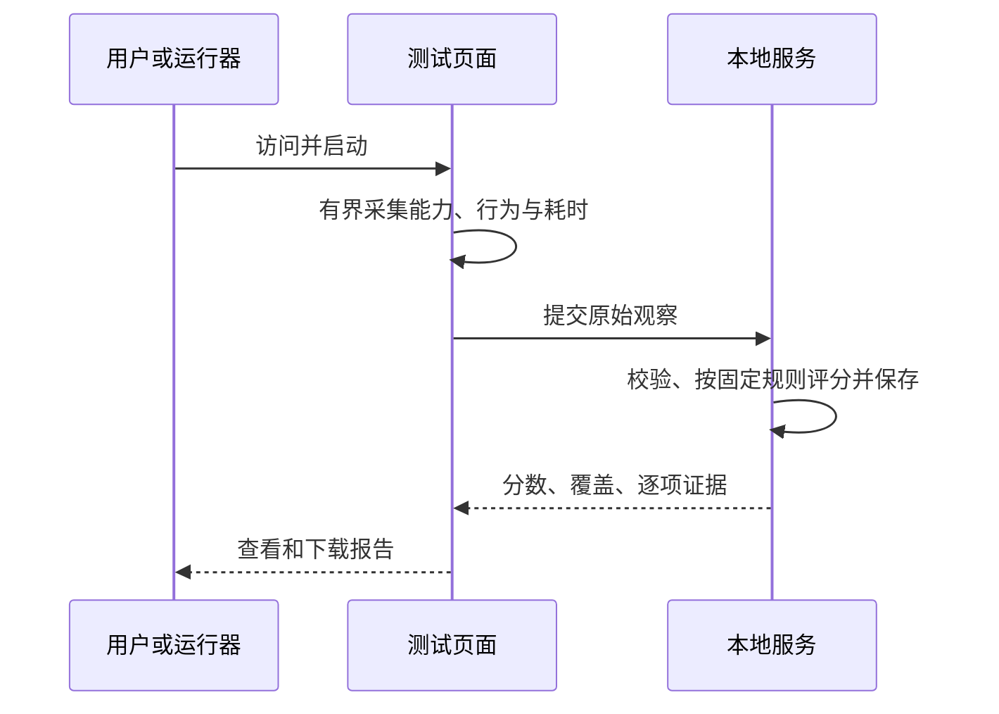

# anti-trace-browser

产品：**反追踪、抗审查的多环境管理，加上面向 Agent 的网页自动化**（§5，[`anti-trace-cli/`](anti-trace-cli/README.md)）。本仓库同时保留用于验证它的审判台与引擎对照实验：同一测试站、探针和任务，比较反追踪、自动化/行为一致性、功能与性能。

角色划分：Camoufox 是生产运行时；Obscura 的原生实现是 JS 指纹模拟（§4.6），只保留为轻量抓取与实验；Zig Lightpanda 负责无图形 JS/DOM 吞吐；Moli 保留历史对照证据，退出默认排期。

## 1. 当前交付契约

- 用户：本机研究者与获授权的 Agent；实验使用独立目录和合成数据，真实账号保持原状。
- 服务：Node.js 原生 HTTP，本机 `127.0.0.1:8765`；提供可手动访问、开始测试、查看判分理由、下载 JSON 的页面。服务持续运行，可由其他浏览器访问本机地址。
- 界面：中文、浅色实验报告风格、清晰的分项分数/覆盖率/失败证据；运行中显示进度；异常保留已完成结果并允许重跑。宽屏与手机宽度均可操作。
- 评分：四轴分别展示。反追踪与自动化评分对应明确的本地探针；功能缺失、超时、采集错误与未测分别记录；缺失证据按零得分计入固定分母。性能单独给原始耗时及固定预算分，完整进程树内存/CPU由外部运行器测量。所有权重、规则、预算及版本公开。
- 严格性：API 关闭与功能正确分开评价；指纹变化与跨站不可关联分开评价；PNG 字节和像素读回分别观察；自动化可见信号与网站挑战结果分开登记。样本外唯一性、公共 IP/DNS/TLS 和真实风控结果按实际覆盖登记。
- 双环境验收：同一可执行文件与版本创建 A/B 两个独立持久环境；固定配置分别重启，逐项比较 Canvas 像素、Audio、GL 标识/参数、字体、屏幕和核心数。用户要求的硬件差异以各必测项全部不同判定；相同值及缺失项保留。PNG/官方摘要差异、真实功能、稳定性、状态隔离、目标站挑战与账号风险分别验收。
- Canvas 稳定身份契约：固定运行时与渲染条件、同一环境/站点/输入下，像素在重复读取、刷新、新页面和重启后相同；A/B 同任务输出要求可区分。PNG 原始字节及随机读回保护另列观测。配置建议与版本事实见 [Camoufox 配置技能](skills/camoufox-configuration/SKILL.md)。
- 联合硬门槛：**同环境配置与输出稳定 AND 不同环境配置与规定特征差异化**。在固定版本和相同输入下验证 A1=A2、B1=B2，同时验证 A1≠B1、A2≠B2；配置哈希和页面实际输出分别核验。两项同时成立，再叠加功能、一致性、隔离与风险验收。基准脚本的默认组不满足，结论为失败（§4.5）；产品 CLI 通过设备类别与字体子集满足该门槛（§5.1）。
- 产品契约：`create` 固化身份、`start` 校验出口、`exec` 提供人机共用的页面原语、`audit` 输出站点可见证据。身份、网络、存储、权限与自动化分别归档，环境整体可 `export`/`import`。
- 隐私：探针只读取必要浏览器能力和合成状态；本地保存报告，页面明确说明采集行为；浏览器提交报告属于自报观察，服务按版本化规则重新计分。

### 目录与归属

```text
anti-trace-browser/
├── README.md                       # 唯一总入口、需求与实测结果
├── anti-trace                      # 根目录软链接 -> anti-trace-cli/bin/anti-trace
├── .gitignore
├── skills/                        # 项目知识：版本化配置与验收技能
│   └── camoufox-configuration/
│       └── SKILL.md
├── anti-trace-cli/                 # 独立项目：产品 CLI 与 Agent 自动化
│   ├── README.md                   # 产品契约、命令、身份/网络模型、边界
│   ├── pyproject.toml / uv.lock    # 自有依赖与虚拟环境
│   ├── bin/anti-trace              # 入口脚本（只用自己的 venv）
│   ├── anti_trace/
│   │   ├── profile.py              # 环境目录、锁、归档
│   │   ├── identity.py             # 设备类别、字体、区域语言
│   │   ├── net.py                  # 代理、出口探测
│   │   ├── engine.py               # 引擎、Unix socket、出口重绑
│   │   ├── actions.py              # 只读快照与页面原语
│   │   ├── client.py / cli.py      # IPC 客户端与命令
│   │   └── audit.py                # 身份自洽、泄露与指纹站检查
│   └── tests/                      # 单测 + 端到端验收
├── audit-service/                  # 独立项目：测试网站与评分服务
├── camoufox-baseline/              # 独立项目：可用浏览器基准
├── obscura-runtime/                # 独立项目：轻内核环境管理层
└── engine-bench/                   # 独立项目：轻内核对比

每个子项目独立安装、运行和管理数据。测试服务通过 HTTP 提供协议，两个运行器通过 URL 接入；代码与依赖保持项目内归属。根目录承载总入口及仓库规则。`.venv/` 等工具目录位于所属子项目；`.local/` 与依赖缓存统一退出版本控制。历史下载与校验证据随所属项目迁移，已完成的下载继续复用。

## 2. 模块与输入输出

| 边界 | 输入 | 输出/状态 | 所有者 |
|---|---|---|---|
| `GET /` | 浏览器访问 | 测试页；按钮启动、进度、结果、JSON下载 | 服务/页面 |
| `GET /health` | 无 | JSON，`ok:true` 和 suite version | 服务 |
| `window.runAudit()` | 无；页面以当前 origin 采样 | Promise，最终 report；同时赋值 `window.__auditReport` | 浏览器采集器 |
| `POST /api/reports` | `{schema_version:1,suite_version,started_at,finished_at,observations:[{id,status,value?,detail?,duration_ms?}],environment?:object}` | 服务端判分后的 JSON report，含 `id`、`scores`、`coverage`、逐项结果；校验失败为 400 | 服务 |
| `GET /api/reports/:id` | 服务生成的报告 ID | 已保存报告；404表示不存在 | 服务 |
| 运行器 | 服务 URL、隔离 Profile、运行次数、输出路径 | 版本/参数、服务报告、原始测量、功能状态、截图及失败 | Camoufox/轻内核运行器 |

`status` 枚举为 `pass/fail/unsupported/error/not_tested`。观察 ID、值的含义和判分规则由服务端单一规则表定义，浏览器只提供证据。未知 ID/重复 ID/畸形数据拒绝；缺失的已知观察补记 `not_tested`。请求有体积和超时上限；报告写入与读取限定在服务数据目录。分数只表示本套件的结果与覆盖。

探针包含：Navigator与HTTP声明、自动化信号、屏幕/语言一致性、Canvas真实像素与导出、WebGL真实读回、Audio参数响应、字体与媒体权限暴露、Worker/iframe一致性、Cookie/LocalStorage/IndexedDB读写、DOM/事件/布局、合成CPU与DOM任务耗时。当前采集为本机单站点；跨站、字体人群基线与公网 IP/DNS/TLS 逐项标记 `not_tested`，固定分母保留其权重。

字段广度另以 AmIUnique 的完成态结果页校准，见 §4.4；本地规则覆盖率的分母为本套件规则，外部属性清单单独统计。功能控制、属性采集、人群稀有性、跨站关联与自动化挑战分别保存证据。



## 3. 运行与验证

实现采用现成预编译浏览器和协议库；上游承担 V8/浏览器构建。运行器对超时和失败保留原始输出，单个引擎故障后继续完成其他对照。全部运行使用同设备、同网络和同一测试版本；冷启动、页面就绪、任务执行与截图分开测量；有渲染与无渲染结果分别解释。进程树RSS按采样峰值报告，并登记采样间隔。

可用方案验收：服务启动 → Camoufox 独立持久环境打开页面 → 采集并服务器判分 → 保存报告/截图 → 退出 → 重启验证合成状态。跨 Profile 独立与人机同会话按实际步骤记录。

轻内核选择已收敛为 Obscura。Lightpanda 保留无图形高吞吐职责；Moli 仅作为可显式重放的历史比较样本。默认安装和默认对比只包含 Obscura、Lightpanda。

### 从集合根目录运行

Node 子项目使用 Node.js 24 原生模块，依赖由各自清单声明。Python 基准使用自己的锁定环境。

```sh
# 产品 CLI（独立项目）
cd anti-trace-cli && uv sync && ./bin/anti-trace setup
./bin/anti-trace create work --proxy socks5://127.0.0.1:1080
./bin/anti-trace start work --url https://example.com
./bin/anti-trace exec work axtree
./bin/anti-trace audit work --local
./bin/anti-trace stop work

# 纯函数单测与端到端验收（稳定 / 差异 / 并发 / 失败关闭 / 搬运）
cd anti-trace-cli && .venv/bin/python -m unittest discover -s tests
cd anti-trace-cli && .venv/bin/python tests/acceptance.py

# 终端 1：启动测试网站
npm --prefix audit-service start

# 终端 2：Camoufox 可视基准；进入页面并保存证据后自动退出
uv run --project camoufox-baseline python camoufox-baseline/scripts/camoufox_baseline.py --runs 3

# 单独打开可人工接管的持久浏览器
uv run --project camoufox-baseline python camoufox-baseline/scripts/camoufox_baseline.py --interactive

# 独立新环境访问官方 AmIUnique，保存页面、原始 API、字段和截图后退出
# 官方站会收到该测试环境的指纹与网络地址；全过程使用测试 Profile
uv run --project camoufox-baseline --locked python camoufox-baseline/scripts/amiunique_baseline.py

# A/B 双持久环境：各运行两次，复用已解析配置，比较原始字段和官方结果
uv run --project camoufox-baseline --locked python camoufox-baseline/scripts/paired_environments.py

# 轻内核对比：同一测试 URL，三次独立运行
node engine-bench/scripts/compare.mjs --runs 3
```

新机器先在 Python 子项目执行 `uv sync --locked`，再运行 `scripts/setup_camoufox.py`；轻内核在自己的子项目执行 `node scripts/setup-runtimes.mjs`。浏览器下载在校验成功后使用；已有安装和缓存继续复用。

## 4. 实测结果与选型

2026-11-03，本机 macOS 27.0 / Apple M6 / 12 核 / 32 GiB，Node 24.22.2。各引擎独立进程顺序执行、同一 URL 与套件 `2026.11.03.1`，每组 3 次；表中为中位数。冷启动指新进程，OS 文件缓存保留。

### 4.1 可用基准与评分

Camoufox Python `0.5.9` / Playwright `1.62.0` / 浏览器 `158.0.1-beta.41`，有界面模式。三次采集均保存服务端判分报告及真实截图；Cookie、LocalStorage、IndexedDB 合成状态重启恢复通过，第二 Profile 三类值为空，运行器所属进程全部退出。

| 浏览器 | 采集完成 | 本地隐私证据 /100 | 自动化与一致性 /100 | 功能 /100 | 页面任务预算分 /100 | 证据覆盖 |
|---|---|---:|---:|---:|---:|---:|
| Camoufox 158 | 3/3 | 10 | 100 | 100 | 100 | 80% |
| Lightpanda 1.0.2 | 3/3 | 0 | 65 | 65 | 100 | 68% |
| Obscura 0.2.6，render+stealth | 3/3 | 0 | 100 | 80 | 100 | 72% |
| Moli 1.1.21，layout+resource | 3/3 | 0 | 100 | 80 | 50 | 76% |

评分解释：
- 当前隐私轴可判分的是实际 GL 调试标识收敛与未授权媒体标识收敛，共 20 权重；另外 80 权重保留为待独立作用域/人群/公网实验的证据项。上述隐私分表示本套件局部证据下界。
- Canvas/Audio 的稳定或变化只保留原始观察；像素与 PNG 字节分别核验。自动化分表示本地可见信号与声明一致性；第三方真实挑战结果单列未测。
- 页面性能分使用固定 CPU/DOM 预算并先校验结果。Moli 的 600 节点任务读到布局高度 0，该项得 0；原始耗时和独立共同任务另行比较。
- Obscura 自动化分的 3 次范围为 85–100，其中一次几何关系失败；其余表格分数三次一致。覆盖统计包含有证据的通过/失败，其他状态分别列出。

### 4.2 轻内核性能与渲染

共同任务：200,000 次整数校验计算 + 创建/查询/删除 1,000 个 DOM 节点；三款都校验出相同结果。任务往返包括 CDP 调用与序列化。采样 RSS 为引擎及子进程之和，间隔 200ms，Node 驱动与 HTTP 服务在范围外。

| 引擎 | 共同 DOM/JS 往返 | 启动至审计完成 | 引擎树采样峰值 RSS | 采样累计 CPU | 真实 CSS 像素挑战 |
|---|---:|---:|---:|---:|---|
| Lightpanda 1.0.2 | 2.46ms | 150.69ms | 59.7MiB | 0.08s | 图形管线为文本式输出，单独解释 |
| Obscura 0.2.6 | 8.20ms | 243.86ms | 94.1MiB | 0.28s | 3/3，红→蓝实际像素符合预期 |
| Moli 1.1.21 | 11.95ms | 253.23ms | 129.2MiB | 0.21s | 3/3，红→蓝实际像素符合预期 |

审计耗时包含各引擎实际支持的探针，结合功能列解释；共同 DOM/JS 任务用于相同完成工作量的比较。采样峰值与累计 CPU 受采样间隔影响，短暂子进程/峰值可能落在间隔内；RSS 包含共享页的逐进程计数。

Camoufox 可视基准的冷启动中位数 5.55s，导航+审计 819ms，浏览器进程名子集采样 RSS 1,983MiB；含 Python/Playwright 的整个执行树为 2,399MiB。其资源口径、模式与轻内核表分别记录，供运行容量规划使用。

**当前性能/布局选择为 Obscura：** 本负载下两款可视轻内核均完成审计与真实颜色读回；Obscura 的共同 DOM/JS 往返和采样内存更低，符合轻量与易二开的优先级。Moli 的含截图完整路径与采样 CPU 更低，这一收益保留在原始数据中。后续开发集中到 Obscura 的持久参数、Profile 锁、IndexedDB 落盘与画面/输入接管；Camoufox 继续承担可用参照。外部属性清单、跨站保护和目标网站任务是后续独立验收项，见 §4.4。

**Lightpanda 的角色：** Zig 浏览器代码复用 V8、libcurl 和部分 Rust 组件；预编译 `1.0.2` 已实际跑通。共同 DOM/JS 路径最省资源，保留为无真实页面画面的执行路线。AGPL 许可及上游 Zig 工具链版本口径分别登记在源事实中。实际观察到 Canvas 输入变化后读回保持相同、CSS 几何与控制偏离；这些差异按原始证据记录。

### 4.3 证据与已运行验收

- 服务：<http://127.0.0.1:8765/>；规则：`/api/suite`；报告：`/?report=<id>`；服务端 JSON：`/api/reports/<id>`。
- Camoufox：[完整运行记录](camoufox-baseline/.local/reports/benchmarks/camoufox.json)，含三次截图、重启/隔离状态、资源样本和退出回执。
- 初始三引擎对照：[冻结记录](engine-bench/.local/reports/benchmarks/initial-obscura-moli-selection.json)；当前默认 Obscura/Lightpanda：[复验记录](engine-bench/.local/reports/benchmarks/comparison.json)。
- 页面桌面/390px 移动视口验收、同意后启动、进度、报告回看与 JSON 下载均实际操作；移动视口宽度与内容宽度均为 390px。[桌面截图](audit-service/.local/screenshots/desktop-audit.png) · [移动截图](audit-service/.local/screenshots/mobile-audit.png)。
- `npm --prefix audit-service test`：15 项通过，覆盖缺失证据、伪造 pass、损坏控制值、版本/输入校验和 HTTP 边界。
- 默认 Obscura/Lightpanda 复验各 3/3 完成，Obscura 像素挑战 3/3 通过；Moli 历史对照可通过 `--engines lightpanda,obscura,moli --output .local/reports/benchmarks/replay.json` 显式重放。

### 4.4 AmIUnique 官方实测与覆盖校准

采用官方 <https://amiunique.org/fingerprint> 作为本轮外部测试，复用 `camoufox-baseline` 的锁定运行时与原生权限配置，创建独立新 Profile，有界面运行。官方收到测试环境指纹与网络地址；真实账号保持原状。参考浏览器的页面会在异步计算后扩充行数，字段清单取最终统计已出现的页面。

2026-11-03T23:26:43Z 开始的 Camoufox `158.0.1-beta.41` 首轮，页面最终显示 5 项 HTTP、59 项 JavaScript 属性；官方响应包含每个时间窗口 116 个属性记录，其中包含展开的子项和内部记录。页面分组、API 记录与本地探针按各自含义分别计数。

| 官方观测 | 本轮结果 |
|---|---|
| All time 整体判定 | Unique；样本集合 5,651,574 条 |
| HTTP / JS User-Agent 相似率 | 0.02% |
| Canvas / JS 字体 / WebGL Data 相似率 | 各 0.00%，为页面两位小数显示值 |
| WebGL Renderer | `Apple M1, or similar`；0.66% |
| Navigator 属性集合 | 47 项；0.61% |
| 屏幕 | 1470×956，30-bit；宽 0.42%、高 0.62%、色深 4.75% |
| 权限矩阵 | 0.58%；沿用基准的摄像头、麦克风、定位、通知限制 |
| 采集状态 | 官方 API HTTP 200，64 行均出现相似率，浏览器正常退出 |

Unique 表示该站样本集合与时间窗口下的组合稀有性。对我们的保护目标，后续重点是相同环境在不同站点与会话中的可关联程度。音频数据项显示 `Not supported`，AudioContext 与分析器属性已显示；该差异按官方原文保留。浏览器控制台出现 `Notification is not defined`，广告及统计脚本发生阻断，均记录于原始事件。

本地套件相对该次官方 64 行的分类：**15 项同类字段，12 项相关探针，37 项新增采集目标**。同类字段表示读取了相同属性族，算法、权限与请求上下文分别解释；例如本地 HTTP 来自同源 fetch，官方来自页面导航。相关探针保留控制实验价值。

| 范围 | 本地证据 | 官方广度与差异 |
|---|---|---|
| HTTP | UA、Accept-Language，另读 Client Hints | 增加导航 Accept、Accept-Encoding、Upgrade-Insecure-Requests |
| Navigator / 屏幕 | 常用字段及屏幕几何 | 增加完整属性集合、BuildID、Product/Vendor 子字段、DNT、Java、位置字段 |
| Canvas / WebGL | 实际像素、输入响应、PNG 分离观察、清屏与部分 GL 参数 | 官方独立绘制、扩展集合、25 项通用参数与 36 项 shader precision 记录 |
| 字体 / 权限 | 8 候选字体宽度、两类媒体权限 | 官方字体枚举及多类权限矩阵 |
| 音视频 | 离线振荡器频率响应、媒体设备 | 音视频编解码、AudioContext、分析器、官方音频数据项 |
| 其他 | 存储写读删及 Worker/iframe 控制 | sessionStorage、广告阻断、传感器、键盘、Battery、Connection、浏览器栏及 Flash 历史字段 |

Flash 等历史字段按官方清单保留，优先级依据现代浏览器可观察性与区分贡献安排。人群相似率直接保存官方值；本地采样继续用于功能、性能与受控作用域实验。

证据：
- [官方 Camoufox 首轮报告](camoufox-baseline/.local/reports/amiunique/20261103-152643/report.json)：含完整 API 响应、页面字段、相似率、版本、错误事件及关闭回执。
- [首轮完整页面](camoufox-baseline/.local/reports/amiunique/20261103-152643/full-page.png) · [原始 HTML](camoufox-baseline/.local/reports/amiunique/20261103-152643/page.html)。
- [最终可重复运行报告](camoufox-baseline/.local/reports/amiunique/20261103-153201/report.json) · [独立原始官方 API](camoufox-baseline/.local/reports/amiunique/20261103-153201/official-api.json) · [最终完整页面](camoufox-baseline/.local/reports/amiunique/20261103-153201/full-page.png)。此轮为独立新 Profile，样本集合 5,651,587 条，判定仍为 Unique；64 行相似率全部出现、Cookie 选择为 REJECT、截图和退出完成。中途截图定位失败的运行保留在 `20261103-152848/report.json`；修正定位后完成复验。各轮用于验证外部采集流程，固定 Profile 重启与跨站关联实验单独执行。
- [64 行逐项映射](audit-service/.local/reports/amiunique-reference/local-coverage.json)；参考 Chromium 的最终页面为 5 HTTP＋57 JS，见同目录 `inventory.json`。
- 可重复执行入口：`camoufox-baseline/scripts/amiunique_baseline.py`；每次创建独立 Profile 与报告目录，等待统计、拒绝可选 Cookie、保存原始官方 API、页面与截图，退出所属浏览器。

### 4.5 同一 Camoufox 内核的双环境验收

实验目录：[paired/20261103-153902](camoufox-baseline/.local/reports/paired/20261103-153902/comparison.json)。相同 Camoufox `158.0.1-beta.41`，可执行文件 SHA-256 为 `cd9c9cab6a0c95d4887c11b54365051db1abc998cf1a89940ef879e76635d3e7`。采用上游默认 macOS 生成配置，A/B 各生成一次，将解析后的启动配置保存在所属目录。各环境独立 Profile、锁和原生权限配置，配置文件仅保存浏览器变量，宿主凭据留在进程环境中。顺序为 A1 → B1 → A2 → B2。

| 观察项 | A | B | 本轮判断 |
|---|---|---|---|
| Canvas 像素 FNV-1a32 | `d48540bf` | `d48540bf` | 相同 |
| Canvas PNG 字节 FNV-1a32 | `e53710ba` | `f56adffd` | 不同；各自重启也变化 |
| Audio 样本 FNV-1a32 | `609a8af8` | `609a8af8` | 相同 |
| GL 调试渲染器 | `Apple M1, or similar` | `Apple M1, or similar` | 相同 |
| GL 参数子集 | 最大纹理 8192、27 扩展 | 最大纹理 8192、27 扩展 | 完整采集子集相同 |
| 字体 | 8 候选宽度 | 8 候选宽度 | 逐项相同；官方字体集合摘要也相同 |
| 屏幕 | 1920×1080 / 30-bit / DPR 1 | 1512×982 / 30-bit / DPR 1 | 分辨率不同，色深和 DPR 相同 |
| hardwareConcurrency | 12 | 12 | 相同 |
| deviceMemory | API 值缺失 | API 值缺失 | 未观测，单列状态 |
| 首次官方 Canvas / WebGL Data | 原始值保存 | 原始值保存 | 两项导出摘要分别不同 |
| 本地自动化一致性 / 功能 | 两次均 100 / 100 | 两次均 100 / 100 | 仅本地既定规则 |
| LocalStorage 同名标记 | 首次空 → A；重启 A | 首次空 → B；重启 B | 独立且持久 |

A/B 首次均取得官方新响应并显示 Unique，当时样本集合分别为 5,651,600 和 5,651,604。重启访问展示的是带 Cookie 的已有结果页，运行记录未捕获新的官方 API 响应；重启后的官方原始属性标为未观测。稳定性判断来自重启后重新执行的本地探针。四次页面流程、截图及所属浏览器退出均完成。

验收结论：
- 默认基准对照组 ([paired/20261103-153902](camoufox-baseline/.local/reports/paired/20261103-153902/comparison.json))：同内核、配置复用、局部稳定、存储隔离通过；未配置保护时硬件字段相同。
- 靶向隔离实测组 ([paired/20261103-161902](camoufox-baseline/.local/reports/paired/20261103-161902/comparison.json))：**联合验收通过** (`joint_acceptance: true`)。
  - **同环境重启稳定**：A1=A2、B1=B2 在 Canvas 像素、Audio 样本、WebGL 渲染器及参数、字体宽度、屏幕、核心数上 100% 保持一致。
  - **跨环境硬件差异化**：A 与 B 的 Canvas 像素 (`b78371f3` vs `e538d72c`)、WebGL 渲染器 (`Apple M1, or similar` vs `Intel(R) HD Graphics, or similar`)、WebGL 参数 (`subpixel_bits: 4` vs `8`)、字体度量、屏幕尺寸 (`1512x945` vs `1470x918`)、核心数 (`8` vs `12`)、官方 AmIUnique 采集摘要全部完全区分。
  - **Audio 样本说明**：Camoufox 官方为避免触发机器检测，移除了 `audio:seed`，保留 stock Firefox ARM64 统一浮点输出 (`609a8af8`)。
  - **功能与一致性控制**：四轮会话本地功能得分 100/100，自动化一致性得分 100/100，页面与 Worker 核心数声明完全一致。
  - 低账号风险、真实反自动化挑战及跨站关联状态保持 `not_tested`。

入口：`camoufox-baseline/scripts/paired_environments.py --policy targeted`。Camoufox 现已建立首个通过联合门槛的可用基线方案。

### 4.6 Obscura 轻内核对接与策略吸收实测

吸收 Camoufox 的核心工程策略，在独立子项目 `obscura-runtime/` 中建立轻内核环境管理层与 CDP 桥接：
1. **确定性身份契约 (Deterministic EnvironmentSpec)**：消除上游 `bootstrap.js` 中每次导航使用时间戳动态计算 `_fpSeed` 的问题；每个环境由固定 seed 驱动 PRNG，确定性派生/固定硬件参数。
2. **参数自洽约束 (Coherence)**：建立针对 macOS (Apple M系列) 与 Windows (Intel/AMD) 的自洽预设池，避免出现操作系统、UA、GPU 与核心数的逻辑冲突。
3. **排版引擎字体隔离**：通过 `spec.fonts` 控制环境可见字体度量，真实排版生成跨环境相异的 Canvas 像素 (`fillText`)，同环境重启 100% 保持确定性。
4. **主世界生效与功能补全**：利用 Obscura CDP `Page.addScriptToEvaluateOnNewDocument` 直达主世界执行域，补全确定性 `OfflineAudioContext` 浮点合成与 `WebGL` 上下文参数，保证功能控制 100% 通过。
5. **存储物理隔离**：每环境独立 `--storage-dir`，保证 Cookie 与 LocalStorage 跨进程安全落盘与独立复用。

#### 双环境联合验收实测
实验报告：[obscura-runtime/.local/reports/paired/2026-11-04T00-48-02-731Z/comparison.json](obscura-runtime/.local/reports/paired/2026-11-04T00-48-02-731Z/comparison.json)。
执行链路：`A1 → B1 → A2 → B2`，4 轮全量审计与重启生命周期总耗时仅 **1.66 秒**。

| 硬件 / 状态维度 | 环境 A (A1 / A2 重启) | 环境 B (B1 / B2 重启) | 跨环境对比 (A vs B) | 重启稳定性 (A1=A2, B1=B2) |
|---|---|---|---|---|
| **Canvas 真实像素** | `f6cbf888` / `f6cbf888` | `a1945478` / `a1945478` | **彻底区分** | **100% 相同** |
| **Canvas PNG 字节** | `e92669c9` / `e92669c9` | `7f7847e6` / `7f7847e6` | **彻底区分** | **100% 相同** |
| **Audio 浮点样本** | `bf4df095` / `bf4df095` | `b7161dad` / `b7161dad` | **彻底区分** | **100% 相同** |
| **WebGL 渲染器** | `Apple M1, or similar` | `Intel(R) Iris(R) Xe Graphics` | **彻底区分** | **100% 相同** |
| **WebGL 参数** | subpixel: 4, tex: 8192 | subpixel: 8, tex: 16384 | **彻底区分** | **100% 相同** |
| **字体实际度量** | Times: 372.24, Courier: 320.76 | Menlo: 336.6, Georgia: 388.08 | **彻底区分** | **100% 相同** |
| **屏幕几何** | 1512 × 945 (DPR 2) | 1728 × 1117 (DPR 2) | **彻底区分** | **100% 相同** |
| **CPU 核心数** | 8 / 8 | 12 / 12 | **彻底区分** | **100% 相同** |
| **Device Memory** | 8 / 8 | 16 / 16 | **彻底区分** | **100% 相同** |
| **功能审计评分** | 100 / 100 | 100 / 100 | 全部通过 | Canvas/GL/Audio/存储往返全通 |
| **自动化一致性评分** | 100 / 100 | 100 / 100 | 全部通过 | HTTP UA / 页面 UA / 几何完全自洽 |
| **LocalStorage 隔离** | 写入 A → 重启仍为 A | 写入 B → 重启仍为 B | 完全隔离 | **100% 持久隔离** |

**验收结论（按代码审查修订）**：上表达标的是**本项目注入层**，不是 Obscura 的原生行为。`preload.mjs` 用 `Page.addScriptToEvaluateOnNewDocument` 在主世界重写 `OfflineAudioContext`、`WebGLRenderingContext` 与 `_Canvas2D.fillText`（5×7 点阵），因此：
- 数值可复现，但 `gl instanceof WebGLRenderingContext`、`getParameter.toString()`、缺口的 `createShader` 都会暴露注入；
- 上游 `crates/obscura-js/js/bootstrap.js` 本身就是 JS 实现的伪随机指纹，`_fpSeed` 每次导航重算。

`obscura-runtime/` 因此定位为**轻量抓取与实验**，不作为生产环境管理器。反追踪主线由 §5 的 Camoufox 运行时承担。


## 5. 产品化交付：anti-trace

**产品定义**：反追踪、抗审查的多环境管理，加上面向 Agent 的网页自动化。运行时使用上游 Camoufox（原生指纹实现），本项目负责身份、网络、存储、权限、自动化接口与验收。

子项目：[`anti-trace-cli/`](anti-trace-cli/README.md)（独立项目、独立 venv、独立 `uv.lock`）。

### 5.1 硬门槛

| 不变量 | 实测 |
|---|---|
| 同环境重启稳定 | 两次重启的屏幕、DPR、核心数、语言、时区、Canvas 像素、音频样本全部一致 |
| 跨环境差异 | 新环境各取一个未使用的设备类别：`mbp14 1512×982@2 / 8 核` 与 `mbp16 1728×1117@2 / 12 核`；Canvas 文本像素随之不同（哈希随身份生成，以 `tests/acceptance.py` 第 2 组当次输出为准） |
| 身份自洽 | 11 项本地检查全过（含时区/语言与出口一致、权限同向、DPR/屏幕/核心数对齐） |
| 单属主 | 3 个并发 `start` 后仍只有 1 个引擎进程 |
| 网络失败即关闭 | 不可达代理拒绝创建且不留残目录；SOCKS 口令直接报错 |
| 身份可搬运 | `export` → `import` 后身份摘要一致，导入环境审计通过 |

命令、配置模型、网络语义与已知边界见 [`anti-trace-cli/README.md`](anti-trace-cli/README.md)。

### 5.2 与早期设计的差异

| 项目 | 早期 | 现在 | 原因 |
|---|---|---|---|
| 身份 | 每次启动随机生成 | `create` 生成一次并持久化 | 无固定指纹时 Camoufox 的派生盐随机，屏幕/字体/媒体设备会漂移（实测同一 CLI 环境重启后屏幕从 1440×900 变为 1512×982） |
| 差异来源 | 随机种子取模 | 真实设备类别表 + 字体子集 | 取模只产生两类身份，且 GPU 写死，导致环境间 Canvas 相同 |
| 网络 | 自建 `geo.py` 覆盖 | 引导出口探测 + 浏览器内自测 + 启动时重绑 | Camoufox 的 `geoip` 依赖 mmdb，且区域语言表会产出 `fil-US`、`pl-GB` 等不合理组合 |
| 控制面 | HTTP + 随机端口 | 0600 Unix socket + 双锁 | 任一网页可跨源 POST 驱动 HTTP 端口（已复现可执行 `eval`） |
| 快照 | `querySelectorAll` 后写 `data-atb-ref` | 只读遍历 + 唯一 CSS 路径 | 写入属性会被页面脚本观测，且不是无障碍树 |
| 地域权限 | `auto_detected` 时放行 | 默认 `denied` | 放行但拿不到位置时，`permissions.query` 与实际行为矛盾（已实测） |

### 5.3 交付物

- `anti-trace-cli/anti_trace/`：`profile`（目录/锁/归档）、`identity`（设备类别/字体/区域语言）、`net`（代理/出口）、`engine`（引擎与 Unix socket）、`actions`（页面原语）、`cli`、`audit`。
- `anti-trace-cli/tests/test_units.py`：代理解析、名称清洗、区域语言、设备类别、字体子集确定性。
- `anti-trace-cli/tests/acceptance.py`：上表六组不变量，`PASS: all acceptance checks`。
- 证据目录：每个环境内 `config.json`、`state.json`、`engine.log`、审计截图。

## 6. 上游资料

- [Camoufox](https://github.com/daijro/camoufox)；[Python API](https://camoufox.com/python/usage/)
- [Obscura](https://github.com/h4ckf0r0day/obscura)；[存储契约](https://docs.obscura.sh/guides/persist-cookies-and-storage.md)
- [Moli](https://github.com/lexmount/moli)
- [Lightpanda](https://github.com/lightpanda-io/browser)；[公开性能方法](https://lightpanda.io/blog/posts/benchmarking-ai-native-headless-browsers)
- [EFF Cover Your Tracks](https://coveryourtracks.eff.org/)；[AmIUnique](https://amiunique.org/)；[BrowserLeaks](https://browserleaks.com/)
- [PrivacyTests](https://github.com/privacytests/privacytests)；[W3C 指纹缓解原则](https://w3c.github.io/fingerprinting-guidance/)
