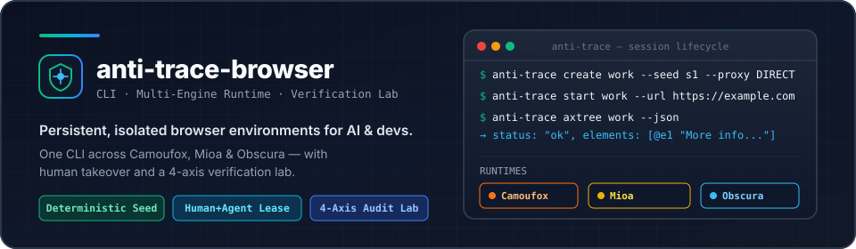
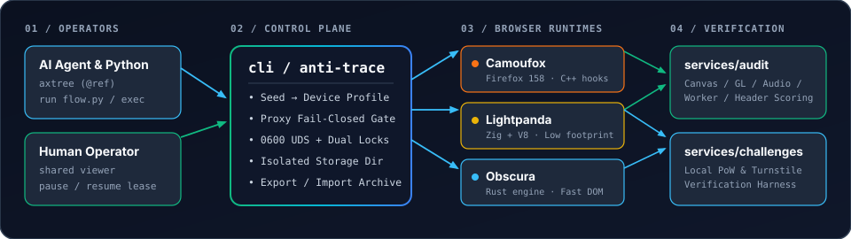

<div align="center">



<br />

**[English](README.md) · [简体中文](README.zh-CN.md) · [CLI Guide](cli/README.md) · [Audit Lab](services/audit/README.md) · [Engine Benchmarks](browsers/engine-bench/README.md)**

</div>

> ⚠️ **Risk Warning**: This project is an experimental browser environment manager and verification toolkit; it does not guarantee network anonymity, censorship circumvention, or automatic bypass of third-party anti-bot systems—never use it with sensitive credentials or in violation of target site terms.

---

## How Browser Tracking & Anti-Tracking Actually Work

Modern web tracking does not rely on cookies alone. Sites correlate users across sessions by combining **network identity** (exit IP, ASN, DNS, WebRTC STUN candidates, HTTP/TLS headers), **hardware & rendering surfaces** (Canvas 2D rasterization, WebGL shader/parameter readbacks, OfflineAudioContext DSP waveforms, font glyph metrics, screen geometry), and **runtime coherence** (whether `Window`, `DedicatedWorker`, `iframe`, and HTTP request headers report the exact same OS, CPU cores, and locale, or expose `navigator.webdriver` and JS prototype tampering).

Naive "anti-detect" tools inject JavaScript (`Object.defineProperty`) or add random pixel noise on every page load—which is immediately flagged because `Function.prototype.toString()`, prototype chains, Worker realms, or known-input rendering checks fail. **anti-trace-browser** enforces coherence at the engine and environment level: each profile derives a deterministic hardware/locale/font contract from a seed, executes real native Canvas/WebGL/Audio pipelines without synthetic noise, isolates storage (`Cookie`, `LocalStorage`, `IndexedDB`), and enforces fail-closed proxy/WebRTC boundaries.


---

## Why Not Chromium? And How Approaches Compare

Most browser automation and multi-account stacks build on **Chromium**, typically falling into three categories:

1. **Stock Headless / Playwright (`Chrome for Testing`)**: Exposes `HeadlessChrome` in User-Agent/Client Hints, `navigator.webdriver=true`, and CDP runtime artifacts. We explicitly removed `Chrome for Testing` from our discovery and baseline pipeline because its default signals are trivially blocked.
2. **JS Stealth Plugins (`puppeteer-extra-plugin-stealth`, etc.)**: Patch `navigator` and WebGL in the main world after context creation. They routinely leak across `DedicatedWorker` / `ServiceWorker` realms, fail `Function.prototype.toString()` or property-descriptor inspections, and cannot govern Chromium's complex `Sec-CH-UA*` High-Entropy Client Hints negotiation.
3. **Commercial Fingerprint Browsers (e.g., AdsPower, Multilogin, Dolphin{anty})**: Ship closed-source Chromium builds coupled to heavy desktop GUIs, cloud profile sync, and per-seat subscriptions. While effective for manual operations, they often rely on random Canvas/Audio noise injection (flagged by known-input statistical checks), consume `1.5–2.5+ GiB` RAM per instance, and lack CLI-first primitives (`axtree`, versioned `@ref` targets, UDS control leases) or open, reproducible verification suites.

**Why we chose a different engine strategy**:
- **Camoufox (Firefox C++ hooks)** avoids Chromium's Client Hints surface (`Sec-CH-UA*`) entirely and intercepts hardware/font/locale queries at the native C++ layer rather than via page-world JS shims.
- **Mioa (Zig + V8) & Obscura (Rust)** give us small, auditable native codebases where we can patch `Window`/`Worker` realms, font shaping, Canvas/WebGL/Audio computation, and storage isolation directly in source—running full 8-step agent workflows under `900–990 MiB` process-tree RSS in `< 190 ms`.

| Approach | Engine Layer | Fingerprint Mechanism | Worker / Realm Coherence | RAM per Session | AI Agent & CLI Native | Open Verification Suite |
|---|---|---|---|---|---|---|
| **Playwright / Stock Chromium** | Chromium (`Chrome for Testing`) | None (exposes `HeadlessChrome` & CDP) | Consistent but flagged | ~1.2–2.0 GiB | Scripting only | No |
| **JS Stealth Wrappers** | Stock Chromium + JS injection | Main-world `Object.defineProperty` | Fails in Worker / iframe | ~1.2–2.0 GiB | Scripting only | No |
| **Commercial Multi-Account Browsers** *(AdsPower, Multilogin, etc.)* | Closed-source Chromium fork | Closed hooks + random Canvas/Audio noise | Partial (closed-box) | ~1.5–2.5+ GiB | GUI-first + REST API | Closed |
| **anti-trace-browser** | **Camoufox** (Firefox C++) + **Mioa** (Zig) + **Obscura** (Rust) | Deterministic seed → real native rendering & font metrics (zero fake noise) | Verified across Window / iframe / Worker (`32/32` matrix) | **890–985 MiB** (native) / 1.88 GiB (Camoufox) | `axtree` (`@ref`), async Python runner, shared human lease | Built-in 4-axis `services/audit` & PoW/Turnstile testbed |
---

## Installation

### Option 1: Copy-Paste Prompt for Your AI Agent (Claude Code / Cursor / Codex)

Copy this single block and send it to your coding agent to install, verify, and wire up **anti-trace-browser**:

```text
Clone https://github.com/anti-trace/anti-trace-browser (or use the current repository root), run `cd cli && uv sync --locked && ./bin/anti-trace setup`, then verify the installation by creating an isolated environment (`./bin/anti-trace create agent-demo --runtime camoufox --seed agent-demo --proxy DIRECT`), starting it headless on https://example.com/, running `./bin/anti-trace axtree agent-demo --json`, and stopping the session. Read `cli/README.md` and `skills/camoufox-configuration/SKILL.md` before automating tasks.
```

### Option 2: Install from Source

Requires **Python 3.12+**, **[uv](https://docs.astral.sh/uv/)**, and **Node.js 24+** (for the local audit and challenge services).

```sh
# 1. Install CLI and download the locked Camoufox runtime + calibrate host fonts
cd cli
uv sync --locked
./bin/anti-trace setup

# 2. Create, start, inspect, and stop an isolated environment
./bin/anti-trace create demo --runtime camoufox --seed demo-env --proxy DIRECT
./bin/anti-trace start demo --headless --url https://example.com/
./bin/anti-trace axtree demo --json
./bin/anti-trace stop demo
```

`anti-trace` and the headless service share [`mioa-core`](https://github.com/guileen/mioa-core). `cli/pyproject.toml` pins `mioa-core` to the immutable full commit `fff9c4f3121b5989bf8c5d87ee1f1870be56728c` (the `mioa-core` subdirectory of that repository) and `cli/uv.lock` records it. The headless source is not duplicated here: `core/` is a Git submodule of that same repository, pinned by gitlink to the identical commit and providing `core/mioa-core/mioa_core` and `core/mioa-headless/mioa_headless`. Run `git submodule update --init core` after cloning; no second copy of the headless source or sibling checkout is used.

### Option 3: Mount Built-in Agent Skills

This repository includes ready-to-use agent skills under [`skills/`](skills/) for AI assistants:

- [`skills/camoufox-configuration/SKILL.md`](skills/camoufox-configuration/SKILL.md) — Environment identity, proxy/WebRTC policies, and paired-profile stability rules
- [`skills/kernel-port/SKILL.md`](skills/kernel-port/SKILL.md) — Native runtime patching and verification workflow for Mioa & Obscura

---

## Verified Capabilities & Test Sites

Every claim in this repository is backed by reproducible test harnesses (`cli/tests/acceptance.py`, `services/audit/`, `services/challenges/`, and `browsers/engine-bench/`). We strictly separate **verified passes** from **active challenges / pending gates**:

### 1. Core Security, Proxy & Identity Invariants (Verified Pass)

| Capability | Verification Method | Measured Result |
|---|---|---|
| **Proxy Fail-Closed Gate** | `cli/tests/acceptance.py` & `cli/tests/test_units.py` | **Pass** — Unreachable SOCKS5/HTTP proxies or invalid credentials abort `create`/`start` immediately; zero fallback to direct host network and no leftover directory. |
| **WebRTC Leak Protection** | Strict egress policy (`--egress-policy strict`) | **Pass** — When bound to a proxy under `strict` policy, WebRTC defaults to `block` to prevent direct UDP STUN leaks; attempting `--webrtc spoof` under strict proxy returns `capability_unavailable` instead of silently downgrading. |
| **Same-Environment Restart Stability** | `32/32` lifecycle matrix (`A1/B1/A2/B2` × 2 sites × reload/new-tab/restart) | **Pass (32/32)** across Camoufox, Mioa, and Obscura — Screen, DPR, cores, locale, timezone, Canvas pixels, Audio samples, and `Cookie`/`LocalStorage`/`IndexedDB` persist identically across restarts. |
| **Cross-Environment Isolation (`A` vs `B`)** | Paired-profile harness (`paired_environments.py --policy targeted`) | **Pass** — Distinct seeds select non-colliding hardware/font presets; Canvas text pixels (`b78371f3` vs `e538d72c`), WebGL renderer, screen geometry, CPU cores (`8` vs `12`), and storage are 100% isolated. |
| **Real Rendering & Computation (`authenticity-2`)** | `browsers/engine-bench/acceptance/authenticity-race.mjs` | **Pass** — Camoufox (`153/153`), Mioa (`154/154`), Obscura (`150/150`). Verifies real Canvas geometry/glyphs, OfflineAudioContext frequency response, WebGL shader readback, and Window/iframe/Worker coherence. |
| **Control Plane & Single-Owner Lease** | Concurrent `start` stress test & `0600` Unix Domain Socket | **Pass** — 3 concurrent `start` calls yield exactly 1 browser engine process; eliminates local HTTP port cross-origin hijacking. |

### 2. Where We Test: Verification Targets & External Sites

We evaluate runtimes across **four tiers of targets**, distinguishing browser capability from exit-IP reputation:

| Target / Site | Category | What Was Tested & Observed |
|---|---|---|
| **`services/audit` (`127.0.0.1:8765`)** | Self-hosted 4-Axis Probe Suite (58 unit tests + 459-item manifest) | **Pass on local functional & coherence axes (`100/100`)** — Verifies Navigator/HTTP header alignment (`HTTP/1.1` & `HTTP/2`), Worker/iframe realm consistency, storage round-trips, and Canvas/WebGL/Audio execution. |
| **`services/challenges` (`127.0.0.1:8788` & `fingerprint-test.ipub.io`)** | Self-hosted PoW Gate & Cloudflare Turnstile Durable Object Worker | **Pass (`cleared` on local PoW & controlled Turnstile authority; `8/8` SQLite+HTTP replay tests)** — Headless HTTP clients receive `403`; managed browser executes `crypto.subtle` SHA-256 PoW and single-use nonce token redemption (`AttemptObject`). |
| **[AmIUnique.org](https://amiunique.org/fingerprint)** | Live External Fingerprinting Site (`5.65M+` sample pool) | **Verified end-to-end collection (`HTTP 200`, all 64 HTTP + JS attributes & similarity ratios captured)** — Used to calibrate our local probe coverage and verify that paired environments `A` and `B` produce distinct external fingerprint digests. |
| **Live Anti-Bot Field Targets** (`nowsecure.nl` Cloudflare Turnstile, `kasada.io` Kasada, `datadome.co` DataDome, `humansecurity.com` HUMAN) | Live Third-Party Bot-Protection Field Harness (`anti-trace field`) | **Honest attribution recorded** — Under a datacenter exit IP (`AS8796`), both Camoufox and real Chrome hit managed `challenge` / `403` on Turnstile/Kasada/HUMAN, while DataDome served a `challenge` to Camoufox vs `403 blocked` to default automated Chromium. `anti-trace field` records `cleared` **only** when backed by a verified server receipt—never faking a pass from an HTTP 200 or redirect. |

---

## Mioa Headless (`mioa-headless`)

`mioa-headless` is the open-source local session service and high-throughput frame producer for the **Mioa (`mioa` / Zig + V8)** runtime. It and the CLI use one shared core pinned to an exact commit: profile/lease storage, native launch/config projection, references/operations, ownership control and the engine live in `mioa_core`, while product-only code (Camoufox adapter, viewer, manager, trusted-script supervisor and CLI commands) stays in `anti_trace`. `anti_trace.profile`, `anti_trace.net`, `anti_trace.native` and `anti_trace.native_spec` are removed; import `mioa_core.profile`, `mioa_core.net`, `mioa_core.native` and `mioa_core.native_spec` instead. The service is the pinned `core/` submodule (`core/mioa-headless`); initialize it with `git submodule update --init core`.

Capabilities:

- **Zero-Copy Shared-Memory Frame Ring (`LPFR` v2)**: Streams raw RGBA frames over `mmap` shared memory synchronized with native C11 acquire/release atomics (`libmioa_frame_atomics.dylib`), eliminating PNG/JPEG encode/decode overhead between the headless engine and pixel consumers.
- **`0600` UDS Session & Tab Control Plane**: Exposes deterministic multi-tab lifecycle, navigation, input dispatch, and atomic page-fingerprint guards over a private `0600` Unix Domain Socket—avoiding localhost TCP port exposure or cross-origin hijacking.
- **100-Tab Isolated Context Scale**: Bounded V8 context governance (`512` ceiling) with pre-flight capacity checks supports **100 concurrent live tabs** with isolated observer worlds and **0 main-world prototype or variable leaks**.
- **Low Footprint & Sub-200ms Execution**: Executes full 8-step workflows in **181.3 ms** (median) under **890.9 MiB** p95 process-tree RSS, passing **32/32** restart/storage persistence checks, **154/154** `authenticity-2` native rendering checks, and **72/72** headless unit and lifecycle tests.

## Architecture & Repository Layout

<p align="center">
  
</p>

```text
anti-trace-browser/
├── assets/                     # SVG architecture diagrams and engine badges
├── cli/                        # Product CLI: environment lifecycle, proxy checks, axtree, Python runner
├── browsers/
│   ├── engine-bench/           # Cross-engine benchmarks, authenticity checks, native build scripts & patches
│   ├── camoufox-baseline/      # Reference experiments, AmIUnique runner & paired-profile harnesses
│   └── obscura-runtime/        # Archived JS-injection prototype (kept for historical comparison)
├── services/
│   ├── audit/                  # Standalone browser probe UI, HTTP header inspector, and versioned scoring API
│   └── challenges/             # Local PoW gate and Cloudflare Turnstile Worker verification testbed
├── core/                       # Git submodule: mioa-core@fff9c4f (shared core + headless service, open source)
├── openspec/                   # Architecture specs, test contracts, and acceptance ledgers
└── skills/                     # AI Agent skills for runtime configuration and kernel porting
```

---

## Runtime Comparison

All three runtimes are driven through the same `anti-trace` CLI and evaluated against identical 8-step workflows (`1280×800@1` on Apple Silicon M-series, 10 measured runs after 2 warmups):

| Runtime | Engine Base | Lifecycle & Storage (`32/32`) | Authenticity Suite (`authenticity-2`) | Task Latency (median) | Process Tree RSS (p95) | Best Suited For |
|---|---|---:|---:|---:|---:|---|
|  **Camoufox** | Firefox `158.0.1-beta.41` | 32/32 pass | 153/153 pass | 195.5 ms | 1,878.5 MiB | Full web compatibility & mature rendering |
|  **Mioa** | Zig + V8 (source build) | 32/32 pass | 154/154 pass | 181.3 ms | 890.9 MiB | Low-footprint execution & fast startup |
|  **Obscura** | Rust (source build) | 32/32 pass | 150/150 pass (`4` Worker Canvas/GL unsupported) | 162.7 ms | 985.9 MiB | Fast DOM/JS round-trips & lightweight rendering |

> **Current Release Gate Note**: While the 32-cell stability matrix and `authenticity-2` checks pass above, the strict 459-item / 22-scenario full release ledger (`2026.11.04.4`) remains open (`428/459` on Camoufox & Mioa, `427/459` on Obscura) pending residential-proxy cross-exit matrices, cross-host archive portability, and live third-party challenge sign-off. See [`openspec/changes/evaluate-lightweight-runtime/tasks.md`](openspec/changes/evaluate-lightweight-runtime/tasks.md).

---

## Common Workflows

### 1. Run Trusted Async Python Workflows

```python
# flow.py
async def main(page, context, tools):
    await page.goto(tools.args["url"])
    tree = await tools.axtree()
    return {"title": await page.title(), "elements": len(tree["elements"])}
```

```sh
./cli/bin/anti-trace run demo flow.py --args '{"url":"https://example.com/"}' --json
```

### 2. Human + Agent Shared Control

```sh
./cli/bin/anti-trace viewer demo           # Open live shared session viewer
./cli/bin/anti-trace control demo pause    # Hand input lease to human operator
./cli/bin/anti-trace control demo resume   # Return lease to automation
```

### 3. Audit & Field Testing

```sh
# Start local audit server on http://127.0.0.1:8765/
npm --prefix services/audit start

# Run local probe audit, header inspection, or challenge field test
./cli/bin/anti-trace audit demo --local --json
./cli/bin/anti-trace field demo --sites http://127.0.0.1:8788/ --json
```

---

## Verification & Test Suites

Run the automated test suites from the repository root:

```sh
# CLI unit & acceptance tests (82 unit tests + 6 invariant groups)
cli/.venv/bin/python -m unittest discover -s cli/tests

# Audit service scoring & boundary tests (58 tests)
npm --prefix services/audit test

# Challenge PoW & Turnstile authority tests (8 tests)
npm --prefix services/challenges test

# Headless service tests (from the pinned core/ submodule)
git submodule update --init core
uv run --locked --project core/mioa-headless python -m unittest discover -s core/mioa-headless/tests
```

---

## Documentation & License

- **[简体中文文档 (README.zh-CN.md)](README.zh-CN.md)** · **[CLI Reference](cli/README.md)** · **[Audit Rules](services/audit/README.md)** · **[Engine Benchmarks](browsers/engine-bench/README.md)** · **[Challenge Testbed](services/challenges/README.md)** · **[OpenSpec Ledger](openspec/changes/evaluate-lightweight-runtime/tasks.md)**
- Licensed under the **[MIT License](LICENSE)**. Upstream browser engines (Camoufox, Obscura, Mioa) and bundled font assets remain subject to their respective licenses (MPL-2.0, AGPL-3.0, OFL-1.1).
