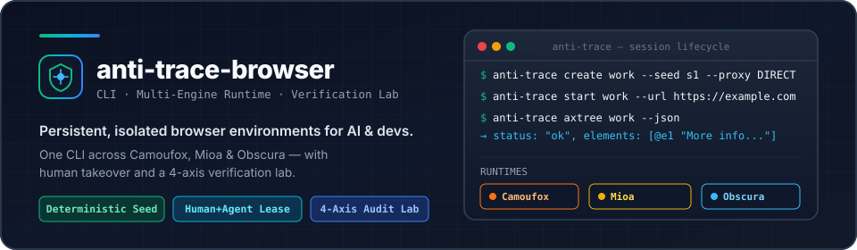
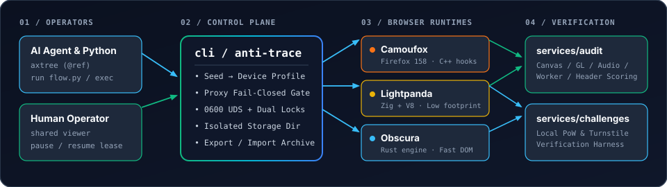

<div align="center">



<br />

**[English](README.md) · [简体中文](README.zh-CN.md) · [CLI 手册](cli/README.md) · [本地审计台](services/audit/README.md) · [引擎评测与构建](browsers/engine-bench/README.md)**

</div>

> ⚠️ **风险提示**：本项目为实验性浏览器环境管理与验证工具，不保证网络匿名、审查绕过或自动通过第三方风控系统；请勿用于敏感凭据或违反目标站点服务条款的场景。

---

## 追踪与反追踪原理简述

现代网站追踪早已不单靠 Cookie，而是将三层信号交叉关联：**网络层**（出口 IP/ASN、DNS、WebRTC STUN 候选地址、HTTP/TLS 握手指纹）、**渲染与硬件表面**（Canvas 2D 光栅化像素、WebGL 着色器与参数读回、OfflineAudioContext 音频 DSP 波形、字体字形度量、屏幕几何）以及**运行时自洽性**（`Window`、`Worker`、`iframe` 与 HTTP 请求头声明的操作系统、CPU 核心数、语言时区是否完全一致，是否存在 `navigator.webdriver` 或原型链篡改痕迹）。

粗糙的“防检测”方案往往通过页面级 JS 注入（`Object.defineProperty`）或每次绘制随机加噪来伪造指纹——这类做法极易被 `Function.prototype.toString()`、Worker 跨界对比或已知输入的图形/音频校验直接识破。**anti-trace-browser** 从引擎与环境管理层实现自洽：每个环境由固定种子（Seed）派生确定性的硬件、字体与区域契约，执行真实的原生 Canvas/WebGL/Audio 渲染计算（不注入假噪声），物理隔离持久化存储（`Cookie`、`LocalStorage`、`IndexedDB`），并在创建与启动阶段强制执行代理与 WebRTC 失败即关闭（Fail-Closed）边界。


---

## 为什么不用 Chrome 内核？以及不同技术路线的对比

目前市面上绝大多数浏览器自动化与多环境工具都建立在 **Chromium** 之上，主要分为三类技术方案：

1. **原生无头浏览器（Playwright / `Chrome for Testing`）**：默认暴露 `HeadlessChrome` 标识、`navigator.webdriver=true` 以及 CDP 调试协议特征。我们在构建基线时已将 `Chrome for Testing` 从发现逻辑与磁盘中彻底移除——其自带的自动化信号会被风控直接拦截，不具备对照价值。
2. **JS 注入隐身插件（如 `puppeteer-extra-plugin-stealth` 等）**：在页面创建后通过主世界脚本重写 `navigator` 或 WebGL。这类方案极易在 `DedicatedWorker` / `ServiceWorker` 中穿帮，无法通过 `Function.prototype.toString()` 与属性描述符检查，也难以完整收敛 Chromium 复杂的 `Sec-CH-UA*` 高熵客户端提示（Client Hints）协商。
3. **商业多账号指纹浏览器（如 AdsPower、Multilogin、Dolphin{anty} 等）**：基于闭源 Chromium 分支，绑定重型桌面客户端、云端配置同步与按席位订阅收费。它们适合人工运营团队，但往往依赖随机 Canvas/Audio 像素加噪（在已知输入的统计真实性核验下反而暴露异常），单实例内存常达 `1.5–2.5+ GiB`，且缺乏面向 AI Agent 的命令行原语（如结构化 `axtree`、带版本保护的 `@ref` 引用、UDS 控制租约）以及公开可复现的验证探针。

**我们为什么选择非 Chromium 的多引擎架构**：
- **Camoufox（Firefox C++ 原生层改造）**：从协议上天然避开 Chromium 的 `Sec-CH-UA*` Client Hints 攻击面，并在 C++ 引擎层拦截硬件、字体与区域查询，不在页面 JS 世界留下篡改痕迹。
- **Lightpanda（Zig + V8）与 Obscura（Rust）**：提供体量精简、可全量源码审计的原生内核。我们可以直接在源码中打通 `Window`/`Worker` 跨界状态、真实字体排版、Canvas/WebGL/Audio 计算与存储隔离，将完整 8 步自动化任务的进程树内存控制在 `890–985 MiB`、耗时压入 `< 190 ms`（同时仍保留 `--browser chromium` / `--cdp` 接口，方便拿本机正式版 Chrome 作外部对照）。

| 技术路线 | 底层内核 | 指纹与环境机制 | Worker / 跨 Realm 一致性 | 单会话内存占用 | AI Agent 与 CLI 原生支持 | 验证标准是否开源可复现 |
|---|---|---|---|---|---|---|
| **Playwright / 原生 Chromium** | Chromium (`Chrome for Testing`) | 无（暴露 `HeadlessChrome` 与 CDP） | 一致但直接暴露自动化 | ~1.2–2.0 GiB | 仅脚本驱动 | 否 |
| **JS Stealth 注入插件** | 原生 Chromium + 页面 JS 劫持 | 主世界 `Object.defineProperty` | Worker / iframe 跨界即穿帮 | ~1.2–2.0 GiB | 仅脚本驱动 | 否 |
| **商业多环境浏览器** *(AdsPower、Multilogin 等)* | 闭源定制 Chromium | 闭源钩子 + 随机 Canvas/Audio 加噪 | 闭源黑盒，无法独立核验 | ~1.5–2.5+ GiB | 重型 GUI 为主 + 本地 API | 闭源黑盒 |
| **anti-trace-browser** | **Camoufox** (Firefox C++) + **Lightpanda** (Zig) + **Obscura** (Rust) | 固定种子派生 → 真实原生渲染与字体排版（零假噪声） | Window / iframe / Worker 全矩阵实测通过 (`32/32`) | **890–985 MiB** (轻内核) / 1.88 GiB (Camoufox) | 结构化 `axtree` (`@ref`)、异步 Python 执行器、人机共享租约 | 内置开源四轴审计台 (`services/audit`) 与 PoW/Turnstile 靶场 |
---

## 安装方式

### 方式一：一键复制给 AI Agent 安装（Claude Code / Cursor / Codex）

直接复制以下指令发给你的编程 Agent，即可自动完成依赖安装、浏览器初始化与冒烟验证：

```text
请克隆 https://github.com/anti-trace/anti-trace-browser（或直接在当前仓库根目录执行），运行 `cd cli && uv sync --locked && ./bin/anti-trace setup` 完成安装；随后创建测试环境 `./bin/anti-trace create agent-demo --runtime camoufox --seed agent-demo --proxy DIRECT`，以无头模式打开 https://example.com/，执行 `./bin/anti-trace axtree agent-demo --json` 验证结构化快照输出并停止会话。后续自动化任务请先阅读 `cli/README.md` 与 `skills/camoufox-configuration/SKILL.md`。
```

### 方式二：从源码安装

环境要求：**Python 3.12+**、**[uv](https://docs.astral.sh/uv/)**，以及 **Node.js 24+**（用于运行本地审计台与挑战靶场服务）。

```sh
# 1. 安装 CLI 依赖，下载锁定的 Camoufox 运行时并校准宿主字体
cd cli
uv sync --locked
./bin/anti-trace setup

# 2. 创建、启动、观察并关闭一个隔离环境
./bin/anti-trace create demo --runtime camoufox --seed demo-env --proxy DIRECT
./bin/anti-trace start demo --headless --url https://example.com/
./bin/anti-trace axtree demo --json
./bin/anti-trace stop demo
```

### 方式三：挂载内置 Agent Skills

仓库在 [`skills/`](skills/) 目录下内置了可直接挂载给 AI Agent 的工程技能包：

- [`skills/camoufox-configuration/SKILL.md`](skills/camoufox-configuration/SKILL.md) — 环境身份派生、代理与 WebRTC 策略、A/B 双环境稳定性规范
- [`skills/kernel-port/SKILL.md`](skills/kernel-port/SKILL.md) — Lightpanda 与 Obscura 原生内核补丁、构建与真实性核验流程

---

## 关键测试通过项与实测站点

仓库中的所有能力声明均对应可复现的测试脚本（`cli/tests/acceptance.py`、`services/audit/`、`services/challenges/` 与 `browsers/engine-bench/`），并严格区分**已验证通过项**与**受出口 IP 影响的在线挑战观察**：

### 1. 网络、安全与环境不变量（已验证通过）

| 关键测试项 | 验证方法与入口 | 实测结论 |
|---|---|---|
| **代理配置与失败即关闭（Fail-Closed）** | `cli/tests/acceptance.py` 与 `cli/tests/test_units.py` | **通过** — 代理不可达或 SOCKS 口令错误时，在 `create`/`start` 阶段立即拒绝启动且不留残留目录，绝不退回本机直连泄露真实 IP。 |
| **WebRTC 泄露防护** | 严格出口策略（`--egress-policy strict`） | **通过** — 绑定代理且启用 `strict` 策略时，WebRTC 默认强制 `block` 以阻断代理外的直连 UDP STUN 探测；若显式传入 `--webrtc spoof` 则直接报错拒绝（`capability_unavailable`），不静默降级。 |
| **同环境跨重启稳定性** | `32/32` 生命周期矩阵（`A1/B1/A2/B2` × 双站点 × 刷新/新标签/重启） | **三内核均 32/32 通过** — 重启前后的屏幕、DPR、CPU 核心数、语言、时区、Canvas 像素、Audio 样本及 `Cookie`/`LocalStorage`/`IndexedDB` 100% 保持一致。 |
| **跨环境硬件与存储隔离（`A` vs `B`）** | 双环境对照脚本（`paired_environments.py --policy targeted`） | **联合验收通过** — 不同种子自动分配不碰撞的设备与字体组合；Canvas 文本像素（`b78371f3` vs `e538d72c`）、WebGL 渲染器、屏幕尺寸、核心数（`8` vs `12`）及存储完全隔离。 |
| **真实绘制与计算（`authenticity-2`）** | `browsers/engine-bench/acceptance/authenticity-race.mjs` | **通过** — Camoufox（`153/153`）、Lightpanda（`154/154`）、Obscura（`150/150`）。独立验证真实 Canvas 字形/几何、Audio 频率响应、WebGL 着色器读回及 Window/iframe/Worker 跨界自洽。 |
| **单属主进程租约与 `0600` UDS 控制面** | 并发 `start` 压力测试 | **通过** — 3 个并发 `start` 请求下仍严格维持唯一浏览器引擎进程；以 `0600` Unix Domain Socket 替代本地 HTTP 端口，杜绝恶意网页跨源劫持。 |

### 2. 我们在哪些网站与靶场做了测试？

我们在**四类目标站点**上进行实测，将“浏览器自身执行与自洽能力”同“出口 IP 声誉”拆开归因：

| 测试站点 / 靶场 | 类型 | 实测内容与结果证明 |
|---|---|---|
| **`services/audit`（`127.0.0.1:8765`）** | 自建四轴浏览器探针审计站（58 项单测 + 459 项规则清单） | **本地功能与自动化一致性满分（`100/100`）** — 覆盖 Navigator/HTTP Header（`HTTP/1.1` 与 `HTTP/2`）对齐、Worker/iframe 跨界一致性、存储往返与 Canvas/WebGL/Audio 真实计算。 |
| **`services/challenges`（`127.0.0.1:8788` 与 `fingerprint-test.ipub.io`）** | 自建 PoW 门禁与 Cloudflare Turnstile Durable Object 验证靶场 | **本地 PoW 门禁与受控 Turnstile 验证核心全部 `cleared`（`8/8` SQLite+HTTP 防重放单测通过）** — 无 JS 客户端返回 `403`；受管浏览器完成 `crypto.subtle` SHA-256 算力证明及单次 Nonce 回执兑换（`AttemptObject`）。 |
| **[AmIUnique.org](https://amiunique.org/fingerprint)** | 外部公开指纹检测站（`565 万+` 样本库） | **完整走通端到端采集（`HTTP 200`，完整捕获 64 项 HTTP + JS 属性及人群相似率）** — 用于校准本地探针覆盖面，并证实同一内核下的 `A`、`B` 双环境在外部检测站生成完全区分的 Canvas/WebGL 摘要。 |
| **第三方真实风控实验场**（`nowsecure.nl` Cloudflare Turnstile、`kasada.io` Kasada、`datadome.co` DataDome、`humansecurity.com` HUMAN） | 外部反自动化实测（`anti-trace field`） | **真实记录归因对照** — 在机房出口 IP（`AS8796`）下，Camoufox 与本机正式版 Chrome 对照组在 Turnstile/Kasada/HUMAN 均停留在 `challenge`/`403`（证明机房出口声誉为主因）；而在 DataDome 上，默认自动化 Chromium 直接被 `403 blocked`，Camoufox 则进入 `challenge`。`anti-trace field` 仅在获得可信服务端回执时才记为 `cleared`，绝不把普通 HTTP 200 或跳转伪报为“绕过成功”。 |

---

## 架构与目录结构

<p align="center">
  
</p>

```text
anti-trace-browser/
├── assets/                     # SVG 架构图与运行时徽标
├── cli/                        # 产品 CLI：环境生命周期、代理校验、axtree 与 Python 执行器
├── browsers/
│   ├── engine-bench/           # 跨引擎基准测试、真实性核验、原生源码补丁与构建脚本
│   ├── camoufox-baseline/      # Camoufox 对照实验、AmIUnique 采集器与 A/B 双环境基线
│   └── obscura-runtime/        # 早期 JS 注入原型（归档保留，供对照参考）
├── services/
│   ├── audit/                  # 独立浏览器探针页面、HTTP Header 检查器与版本化判分服务
│   └── challenges/             # 本地 PoW 门禁与 Cloudflare Turnstile Worker 验证靶场
├── lightpanda-headless/        # 基于 CLI 管理器的无头服务封装
├── lightpanda-desktop/         # 原生桌面端浏览器外壳（独立开发中）
├── openspec/                   # 架构规格说明、验收契约与实施台账
└── skills/                     # 面向 AI Agent 的运行时配置与内核改造技能包
```

---

## 三种运行时对比

三种运行时均通过同一套 `anti-trace` CLI 驱动，并在相同 8 步 CLI 工作流下实测（Apple Silicon M 系列，`1280×800@1` 视口，2 次预热后连续测量 10 次）：

| 运行时 | 内核基础 | 生命周期与存储矩阵 (`32/32`) | 真实绘制与计算套件 (`authenticity-2`) | 完整任务耗时 (中位数) | 进程树采样峰值 RSS (p95) | 适用场景 |
|---|---|---:|---:|---:|---:|---|
|  **Camoufox** | Firefox `158.0.1-beta.41` | 32/32 通过 | 153/153 通过 | 195.5 ms | 1,878.5 MiB | 完整 Web 兼容性与成熟渲染管线 |
|  **Lightpanda** | Zig + V8（源码构建） | 32/32 通过 | 154/154 通过 | 181.3 ms | 890.9 MiB | 低内存占用与快速启动执行 |
|  **Obscura** | Rust（源码构建） | 32/32 通过 | 150/150 通过（`4` 项 Worker Canvas/GL 不支持） | 162.7 ms | 985.9 MiB | 高速 DOM/JS 往返与轻量级渲染 |

> **全量放行台账说明**：上表中的 32 格生命周期稳定性矩阵与 `authenticity-2` 真实渲染核验均已通过；涵盖 22 个产品场景的 459 项严格放行台账（`2026.11.04.4`）目前完成度为 Camoufox `428/459`、Lightpanda `428/459`、Obscura `427/459`，剩余待验项为住宅代理跨出口矩阵、跨主机归档迁移与生产级在线挑战签收，详见 [`openspec/changes/evaluate-lightweight-runtime/tasks.md`](openspec/changes/evaluate-lightweight-runtime/tasks.md)。

---

## 常用工作流

### 1. 运行可信异步 Python 脚本

```python
# flow.py
async def main(page, context, tools):
    await page.goto(tools.args["url"])
    tree = await tools.axtree()
    return {"title": await page.title(), "elements": len(tree["elements"])}
```

```sh
./cli/bin/anti-trace run demo flow.py --args '{"url":"https://example.com/"}' --json
```

### 2. 人机协同接管（Human-in-the-Loop）

```sh
./cli/bin/anti-trace viewer demo           # 打开当前运行会话的共享视图
./cli/bin/anti-trace control demo pause    # 暂停自动化，交由人工输入
./cli/bin/anti-trace control demo resume   # 交还控制租约，恢复自动化
```

### 3. 本地审计与靶场实测

```sh
# 启动本地四轴审计服务（默认 http://127.0.0.1:8765/）
npm --prefix services/audit start

# 执行本地探针审计或靶场挑战测试
./cli/bin/anti-trace audit demo --local --json
./cli/bin/anti-trace field demo --sites http://127.0.0.1:8788/ --json
```

---

## 自动化测试套件

在仓库根目录执行各模块回归测试：

```sh
# CLI 单元与验收测试（82 项单测 + 6 组核心不变量）
cli/.venv/bin/python -m unittest discover -s cli/tests

# 审计服务判分与边界测试（58 项）
npm --prefix services/audit test

# 挑战靶场 PoW 与 Turnstile 验证核心测试（8 项）
npm --prefix services/challenges test

# Headless 服务测试（13 项）
uv run --locked --project lightpanda-headless python -m unittest discover -s lightpanda-headless/tests
```

---

## 文档导航与许可证

- **[English README (README.md)](README.md)** · **[CLI 命令手册](cli/README.md)** · **[审计服务规则](services/audit/README.md)** · **[引擎基准与构建](browsers/engine-bench/README.md)** · **[挑战靶场说明](services/challenges/README.md)** · **[OpenSpec 验收台账](openspec/changes/evaluate-lightweight-runtime/tasks.md)**
- 本仓库代码基于 **[MIT License](LICENSE)** 开源。上游浏览器引擎（Camoufox、Obscura、Lightpanda）与随附字体资产分别遵循其各自许可证（MPL-2.0、AGPL-3.0、OFL-1.1）。
