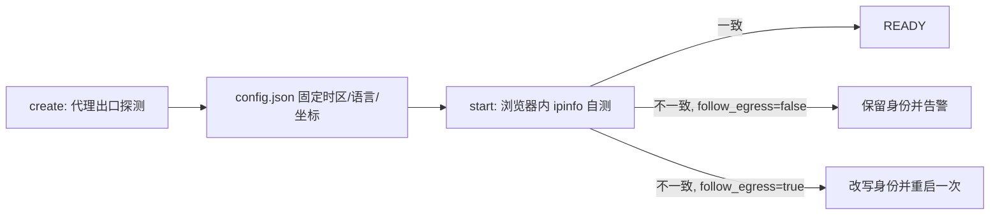

# anti-trace

反追踪、抗审查的多环境管理，加上面向 Agent 的网页自动化。运行时用上游 Camoufox（含 Chromium 级的原生指纹实现），本项目管理身份、网络、存储、权限和自动化接口。

## 1. 它保证什么

| 不变量 | 含义 | 验证方式 |
|---|---|---|
| 环境内稳定 | 同一环境重启后，屏幕、DPR、核心数、语言、时区、Canvas 像素、音频样本一致 | `tests/acceptance.py` 第 1 组 |
| 环境间差异 | 同一运行时的新环境拿到不同设备类别：屏幕、核心数、Canvas 文本像素不同 | 第 2 组 |
| 自洽 | `navigator`、HTTP 声明、屏幕、DPR、权限状态、时区、语言互相一致 | `anti-trace audit <env> --local` |
| 单一属主 | 一个环境同一时刻只有一个引擎；并发 `start` 不会产生孤儿进程 | 第 4 组 |
| 网络失败即关闭 | 代理不可用、出口探测失败时拒绝创建；浏览器出口与预期不符时重新绑定或报警 | 第 5 组 |
| 身份可搬运 | `export`/`import` 后身份摘要、屏幕、字体集合完全一致 | 第 6 组 |

本项目的隐私目标是**减少可关联特征、保持人群一致的外壳**，不是伪造另一台设备。Canvas 几何像素由宿主 GPU 真实渲染，作为「大众一致」的公开属性保留；环境之间的差异来自设备类别、字体集合与网络身份。

## 2. 快速开始

```bash
cd anti-trace-browser/anti-trace-cli
uv sync
./bin/anti-trace setup                 # 安装运行时并校准本机字体
./bin/anti-trace create work --proxy socks5://127.0.0.1:1080
./bin/anti-trace start work --url https://example.com   # 弹窗，可人手登录
./bin/anti-trace exec work axtree                       # Agent 读页面
./bin/anti-trace exec work click @3
./bin/anti-trace stop work
```

`setup` 只做两件事：拉取锁定版本的 Camoufox 二进制、在无头浏览器里测量本机真正可渲染的字体家族并缓存。之后 `create` 不再需要网络（除非要探测代理出口）。

## 3. 命令

```text
anti-trace setup [--skip-fonts]
anti-trace create <name> [--proxy URL] [--os macos|windows|linux] [--cores N]
                         [--fonts host|subset:N] [--webrtc spoof|block] [--follow-egress]
anti-trace start <name> [--headless] [--url URL] [--foreground] [--timeout S]
anti-trace stop <name>
anti-trace list | info <name> | reset <name> | rm <name> [--force]
anti-trace export <name> [file] | import <archive> [--name N]
anti-trace audit <name> [--local] [--leaks] [--fp] [--all]
anti-trace run <name> <script|-> [--json]
anti-trace measure <script|-> [--browser chromium] [--cdp URL]
anti-trace field [name] [--sites URL,URL] [--out DIR] [--browser chromium] [--cdp URL]
anti-trace doctor
anti-trace exec <name> <action> [args] [flags]
```

每条命令都支持 `--json`，输出可直接被 Agent 解析。人类输出为表格或 `key value` 行。

### `exec` 动作

| 动作 | 参数 | 说明 |
|---|---|---|
| `goto` | `url` | `domcontentloaded` 后返回，含真实 `http_status` |
| `axtree` | — | 只读快照：交互元素列表（`@1..@n`）、唯一 CSS 路径、视口标记、总览截图 |
| `click` | `@ref` / `text=...` / `css=...` | 先等可见再点击 |
| `type` | `target` `text` | 逐键输入（`--fill` 改为直接赋值，`--enter` 提交） |
| `press` | `keys` | 如 `Control+A`、`Enter` |
| `hover` / `select` | `target` [`value`] | |
| `scroll` | `--direction up\|down\|top\|bottom` `--amount N` | |
| `wait` | `--selector` / `--url-substring` / `--ms` | |
| `back` / `reload` / `screenshot` / `cookies` | | `screenshot --full-page` |
| `eval` | `js` | 默认隔离世界；`--main-world` 需环境开启 |
| `tabs` / `use <index>` / `tab_new <url>` | | 人机同一窗口多标签协作 |

`axtree` 的引用不写入 DOM：它按确定顺序遍历，返回每条元素唯一的 CSS 路径，`click @3` 时重新计算同一映射。页面在两次调用之间变化时引用可能指向别处，重新 `axtree` 即可。

### headless 实测开销（本机，M5/64GB，单环境）

| 操作 | 耗时 | 说明 |
|---|---:|---|
| `start --headless`（冷启动，含出口校验） | 5.9s | 浏览器启动为主，出口探测约 1.5s |
| `exec <env> eval "1"` | 36ms | 进程边界＋Unix socket 往返 |
| `exec <env> axtree` | 55ms | 扫描当前 DOM 并截图 |
| `exec <env> screenshot` | 55ms | |
| `exec <env> goto <url>` | 2.2s | 网络与 `domcontentloaded` 为主 |
| `exec <env> batch`（4 步） | 156ms | 对照 4 次独立调用 230ms |

模式：**环境常驻，动作批处理**。真实耗时在网络与模型侧，本地往返已降到 100ms 以下；`batch` 把 N 次调用压成 1 次，适合“导航→快照→点击→读值”这类固定序列。

## 4. 环境存储（自解释）

```text
~/.anti-trace/profiles/<name>/
├── config.json   # 0600：身份（指纹、设备类别、屏幕、DPR、核心数、字体）、网络、运行时版本
├── state.json    # 0600：pid、socket、READY/STARTING、观测出口、一致性
├── data/         # Firefox 持久 Profile：Cookie、LocalStorage、IndexedDB、缓存
├── engine.log    # 引擎日志（启动失败时 `start` 会打印尾部）
├── engine.sock   # 0600 Unix socket，仅本用户可连
├── .lock         # 引擎独占锁（fcntl.flock）
└── .spawn        # 启动协调锁
```

`ANTI_TRACE_HOME` 可整体改写到别处（测试、多套身份库）。`ANTI_TRACE_BROWSER` 指定已有二进制，跳过 `setup` 下载。

### 身份模型

- **指纹只生成一次**：`create` 时调用 `camoufox.fingerprints.generate_fingerprint` 并写入 `config.json`。Camoufox 的派生盐（字体、语音、媒体设备、噪声种子）由传入的指纹决定，因此重放同一指纹即可稳定。
- **设备类别**：每个 OS 有一张真实设备表（`macos`: mbp14 1512×982@2/8 核、mbp16 1728×1117@2/12 核、mba13 1440×900@2/8 核、外接 1920×1080@1、1680×1050@1、2560×1440@1…）。`create` 选择当前库里尚未使用的类别，因此屏幕、核心数天然不重复。
- **字体**：`host` 表示沿用宿主真实字体集合（最自洽，Canvas 文本与其他环境相同）；`subset:N` 从校准出的「本机真实可渲染家族」中取一个固定子集，并始终包含 OS 核心家族，从而让 Canvas 文本像素在不同环境之间不同、同一环境重启后不变。代价是可见字体列表比全新安装窄。
- **Canvas**：不开启随机读回。几何像素来自宿主 GPU，环境间共享；这是刻意的「融入人群」选择，随机读回会破坏重启稳定性（实测 `canvas_noise=True` 每次读回都不同）。
- **DPR/窗口**：`window.*` 与 `screen.*` 一起下发，`(min-resolution: 2dppx)`、`device-width` 等媒体查询随之变化。

### Header 模型：没有“未审视的默认值”

实测（同机、同一站点）：

| 客户端 | 协议 | Header 数 |
|---|---|---:|
| Camoufox（Firefox 158） | HTTP/2（example.com） | 11 |
| Camoufox（Firefox 158） | HTTP/1.1（本机靶场） | 12（多 `priority`） |
| Chrome 156（CDP 附加） | HTTP/1.1（本机靶场） | 14（多 `sec-ch-ua` 三项） |

每个 Header 都有归属，谁能改它由类别决定：

| 类别 | Header | 规则 |
|---|---|---|
| identity | `user-agent`、`accept-language` | 随指纹／OS／locale；改 locale，`accept-language` 立即跟着变（实测 `en-US,en;q=0.9` → `ja-JP,ja;q=0.9`） |
| build | `accept`、`accept-encoding` | 随浏览器构建，同族跨环境一致；Firefox 与 Chrome 的 `accept` 本就不同 |
| universal | `upgrade-insecure-requests`、`sec-fetch-dest/mode/site/user` | 规范固定，改动即异常 |
| family | `sec-ch-ua`、`sec-ch-ua-mobile`、`sec-ch-ua-platform` | Chromium 必须有且平台与 OS 一致；Firefox 必须缺席 |
| protocol | `connection`、`priority` | 只在 HTTP/1.1 出现，H2 下消失——不是指纹，不要按环境改 |
| request / origin | `host`、`cookie`、`referer`、`if-none-match`、`range` | 由请求与站点状态决定 |

```sh
./bin/anti-trace audit work --headers
```

判定按 UA 识别家族：Firefox 身份下出现 Client Hints 即失败；Chromium 身份下缺少 Client Hints、或 `sec-ch-ua-platform` 与 OS 不符也失败。未登记的 Header 标 `unknown` 并列出——**新增默认值不会静默通过**。

### 网络模型



- 代理只支持 `http(s)://`、`socks5://`、`socks5h://`；Firefox 不接受 SOCKS 用户名口令，遇到时直接报错，避免假装连通。
- 时区、语言、WebRTC IPv4 从真实出口派生（`ipinfo.io`，失败回退 `ip-api.com`），不依赖本地 GeoIP 数据库。
- **默认固定身份**：出口地理位置是身份的一部分，随出口漂移会让「日本 IP + 日语」之类的组合在下次启动变成矛盾。用地理稳定的代理，或显式 `--follow-egress` 接受漂移。
- WebRTC 默认 `spoof`（把候选地址换成出口 IP），`--webrtc block` 直接关闭 `RTCPeerConnection`。
- 地理位置权限默认 `denied`：`permissions.query` 与 `getCurrentPosition` 同向，不会出现「声称已授权却拿不到位置」的矛盾。

### 步骤脚本：`run`

一行一动作，与 Playwright CLI 同形，不引入新语法；整段走**一次** IPC。

```text
# flow.at
goto https://example.com/
axtree
click @1
type @2 hello world
wait --ms 500
eval document.title
```

```sh
./bin/anti-trace run work flow.at          # 文件
printf 'goto https://example.com/\neval document.title\n' | ./bin/anti-trace run work -
./bin/anti-trace run work '[{"action":"axtree","args":{}}]'   # JSON 形式同样接受
```

动作集合与 `exec` 相同：`goto axtree click type press hover select scroll wait back reload screenshot eval cookies tabs use tab_new`。`--ms`、`--direction`、`--amount`、`--selector`、`--url-substring` 支持 `wait`/`scroll`。解析错误报行号，例如 `line 2: unknown action 'frobnicate'`；执行中失败返回 `status=partial` 与 `failed_step`。

**为什么是脚本而不是 JSON**:同样一次往返，脚本可 diff、可注释、可复制自 Playwright 文档；JSON 只作为机器生成形式保留。

### 对照组：`measure` / `field --browser`

同一套步骤可以打在**我们不管理的浏览器**上，用于归因：

```sh
./bin/anti-trace measure flow.at --browser chromium      # 启动本机已有 Chromium
./bin/anti-trace measure flow.at --cdp ws://127.0.0.1:9222/devtools/browser/...  # 接 Fury/Chrome/Cloak
./bin/anti-trace field --browser chromium                # 四个厂商站跑对照组
```

自动发现顺序：`ANTI_TRACE_CHROMIUM` → Playwright 缓存里的 Chromium → `/Applications/Google Chrome.app`、Brave、Edge → `/usr/bin/google-chrome`。找不到时回退到 Playwright 自带构建。

报告会显式记录 `executable`、`user_agent`、`webdriver`，并在 `target.profile` 标注“未加固的对照组，不代表 Chromium 人群”。

### 实验场：`field`

四个厂商自家站，各自跑自己的机器人防御，业务流量本就被预期为自动化，`robots.txt` 亦放行：

| 站点 | 厂商 | 实测（2026-11-03） |
|---|---|---|
| `nowsecure.nl` | Cloudflare Turnstile | `200`，页面含 `challenge-platform`＋`turnstile` |
| `kasada.io` | Kasada | `200`，页面含 57 个可交互元素 |
| `humansecurity.com` | HUMAN `px-captcha` | `403`，页面要求“Press & Hold to confirm you are a human” |
| `datadome.co` | DataDome | `200`，页面含 `datadome` 与 `recaptcha` |

每次运行写入 `<profile>/field/<timestamp>/`：`report.json`、每个站点的 `*.png` 与 `*.ax.txt`（无障碍快照），供人工逐项复核。判定四类，只描述观测到的状态：

| 判定 | 含义 |
|---|---|
| `reached` | 未遇挑战，直接拿到内容 |
| `cleared` | 先被拦，随后解开并跳转（本机靶场即此例） |
| `challenge` | 停在挑战页，HTTP 2xx |
| `blocked` | 停在挑战页且 HTTP 4xx/5xx |

2026-11-03 同出口（AS8796 机房）双引擎对照：

| 站点 | Camoufox 158 | Chromium（自动化默认，对照组） |
|---|---|---|
| nowsecure.nl | `challenge` 200 | `challenge` 200 |
| kasada.io | `challenge` 200 | `challenge` 200 |
| humansecurity.com | `blocked` 403 | `blocked` 403 |
| datadome.co | `challenge` 200 | `blocked` 403 |

`humansecurity.com` 两引擎同为 403 → 该站的主因在出口（机房 ASN），不在浏览器。`datadome.co` 出现分叉，但对照组带 `HeadlessChrome` UA 与 `navigator.webdriver=true`，这一格不能用来推断“Chrome 比 Firefox 差”。

## 5. 验证

```bash
./bin/anti-trace doctor                       # 安装、字体缓存、运行时版本
./bin/anti-trace audit work --local           # 身份自洽与稳定性（快，不访问第三方）
./bin/anti-trace audit work --leaks           # BrowserLeaks WebRTC/DNS/IP
./bin/anti-trace audit work --fp              # AmIUnique 指纹页
.venv/bin/python -m unittest discover -s tests    # 纯函数单测
.venv/bin/python tests/acceptance.py               # 端到端：稳定/差异/并发/失败关闭/搬运
```

`audit --local` 的检查项：Canvas 读回可重复、`navigator.webdriver` 为假、语言与时区与出口一致、核心数与屏幕与 DPR 与身份一致、地理位置权限自洽、localStorage 可写、音频可渲染、WebGL 存在。出口地理位置与固定身份不符时给出 `warnings`，不算硬失败。

`--leaks`/`--fp` 会导航当前标签页并截图，证据写入环境目录。

## 6. 已知边界

- Canvas 几何像素、WebGL 渲染器在本机所有环境间相同（宿主 GPU 真实渲染）。需要逐环境 GPU 差异时，只能换声称的 GPU，而 Camoufox 会因此启用随机读回，牺牲重启稳定。
- 音频样本来自宿主 ARM64 计算，跨环境一致。上游已移除 `audio:seed`。
- 字体子集会让「未列出的字体全部回退」，这是可被检测的窄字体列表特征；默认 `host` 规避此项。
- 出口 IP 轮换的代理池无法同时满足「身份固定」和「地理位置一致」，只能二选一，`start` 会把矛盾写进 `state.egress_consistent`。
- 反自动化挑战（Turnstile/DataDome）与账号风险不在本项目可判定范围内，`audit` 只提供站点可见证据。
