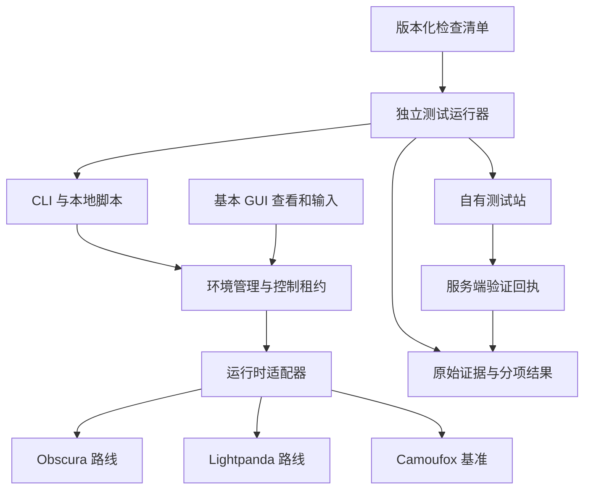
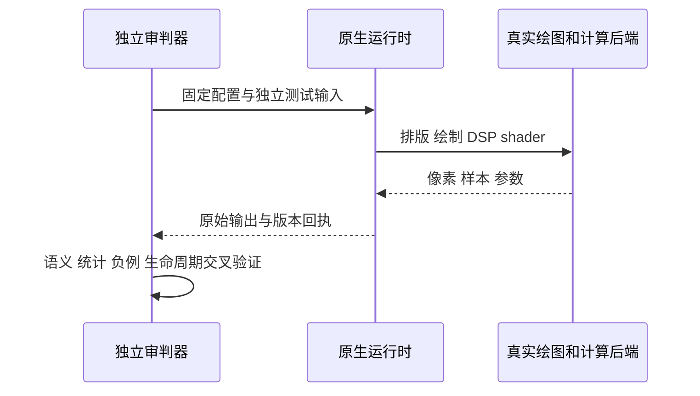
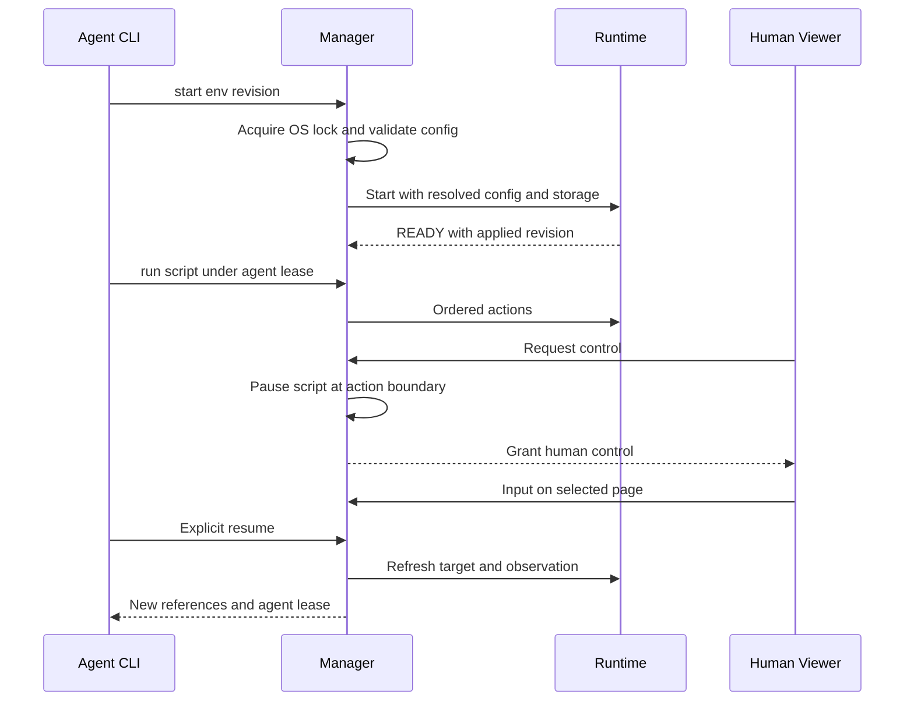

# Design: 轻内核选型、可信验收与产品接入

## 1. Reference / State / Gap

日期：2026-11-04。状态：执行中；源代码风险核验与判据修复已启动，逐项运行回执见 [tasks.md](tasks.md)。

固定需求：基本 GUI、可二开、CLI、Agent headless、seed+覆盖+代理+独立可序列化存储，同环境稳定 AND 不同环境规定特征差异化。2026-11-04用户明确两路都实现、三路赛马，最终选型延后；原先“先选一个再产品化”的依赖撤销。降低复杂历史兼容性要求，复用 JS/排版/网络组件；语言和已有检查通过数不代替真实行为验收。

本轮原始素材：当前实现、既有运行报告索引、实际函数调用。后续主要依据：固定 commit 源码、构建日志、协议帧、服务端 HTTP 记录、输入输出像素/音频样本、进程树资源与人工录屏。先固定判据，再由独立测试输入和外部人审检验实现；评分器和被测运行时各自维护。

| 证据 | 观察 | 对后续决策的影响 |
|---|---|---|
| `cli/anti_trace/field.py:_verdict`；本轮直接调用 | `(200, [], moved=True)` → cleared；`(None, [])` → reached；403+turnstile → blocked | P0 修正证据状态机，重算历史结果 |
| `cli/anti_trace/audit.py:evaluate_headers`；本轮直接调用 | `x-unclassified` 的 class=unknown、result=pass | 未登记头改为 review_required，规则使用上下文 |
| `cli/anti_trace/actions.py:resolve` | 每次点击按当前 DOM 顺序重建 @编号 | 引用增加 page/frame/epoch，原节点失效先返回错误 |
| `cli/anti_trace/attached.py:_call` | 每次连接选择 contexts[0]/pages[0]；STARTUP 错误后尝试新 context | 固定目标 ID；用原始 CDP 帧分离 adapter 与引擎问题 |
| README §4.5、§5.1 历史报告 | 文本 Canvas、部分配置有差异；Audio/几何等覆盖各有范围 | Camoufox 保留局部门槛成绩；逐项记录完整硬门槛差距 |
| `services/challenges/README.md` 历史部署记录 | 公开页 reached；此前权限请求返回 Authentication error | 本轮沿用历史状态；下一步诊断权限范围和资源归属 |

解释修订：WebGL 可用性独立于 UA/CH 平台；语言与时区可由真实用户独立选择；Priority 可用于不同 HTTP 版本；Client Hints 随安全上下文、请求及协商变化；GPC/DNT 属隐私策略。JS/Rust/Zig 实现和 `[native code]` 字样各自属于实现证据，行为正确性通过输入响应、对象语义、调度与跨上下文一致性验收。

Camoufox 的“收尾”定义为功能基准维护模式，保留安全升级和缺陷修复。有限检查集是版本化交付边界；加入独立输入、功能任务与人工审查，持续更新测试覆盖。

### 1.1 身份层实现风险（2026-11-04 源码复核）

JS 实现集中配置、快速迭代与 Web API 胶水具有维护收益；产品风险由实际语义和状态边界决定。Obscura bootstrap使用私有IIFE，`_fpSeed`为闭包let，源码未支持“JS意味着seed公开”的判断。`[native code]` 文本与 Rust/Zig 语言各自作为实现信息记录；输入响应、对象品牌/继承、错误、调度、隔离与真实渲染承担验收。

| 固定源码观察 | 改造成本与判据 |
|---|---|
| Obscura `7c751c5` 的 `bootstrap.js:16218–16248`：Canvas 文字由 seed 派生点阵、度量按字符数计算 | 字体选择与字号、中文等输入需贯通真实排版/光栅化组件；页面 CSS renderer 与 Canvas 分开核验 |
| `bootstrap.js:16639–16684`：Audio 节点连接为空操作，离线样本固定频率并缩放到目标区间 | 引入实际音频图执行/软件 DSP，或显式能力缺席；完整产品 audio gate 保持 outstanding |
| `bootstrap.js:16795+`：Worker 使用同 realm scope、借用 navigator/fetch/indexedDB | 独立 realm、消息与调度、网络和配置作用域共同核验；字段相等只覆盖配置一致性 |
| `obscura-browser/src/context.rs:201–210`：Cookie/LocalStorage 有加载入口，IndexedDB 为内存 store | 增加事务提交、持久编码与启动恢复，测试崩溃和冷归档 |
| Lightpanda 1.0.2 原始 CDP 与上游 Puppeteer 实际完成 context/target/navigation | STARTUP 错误归于特定客户端路径，先修适配器；Zig 候选保持同级 |
| Lightpanda PNG 实际观察为文本画面，CSS 几何与颜色分开验收 | 截图协议可用与基本 GUI gate 分开记录；渲染组件接入成本计入成本卡 |
| Lightpanda发布版实测Worker无document/window、brand为DedicatedWorkerGlobalScope；440/880Hz离线音频为不同非零样本；GL为null | 全局语义与频率输入响应优于Obscura现有实现；完整Worker调度/隔离、Audio图与跨环境差异仍独立验收 |

决策：Obscura、Lightpanda两路推进完整约定能力，Camoufox同场严格复验；没有选型前置门槛。每路独立记录功能、成本、未完成门槛，最终选择待证据。必需项的fail/unsupported/error/not_tested/review_required均阻止整体通过。

## 2. 架构、目录与所有权

| 所有者 | 持有状态 | 依赖与边界 |
|---|---|---|
| `cli/profile.py`、`identity.py` | EnvironmentSpec、resolved、revision、runtime/asset digest | 管理器生成一次；运行时只读已提交版本 |
| `cli/engine.py`、`attached.py` | 进程锁、目标 ID、控制租约、观察引用、当前 run | 托管可关闭进程；attached 只释放己方连接和租约 |
| `browsers/obscura-runtime/`、`lightpanda-runtime/` | 各自真实浏览器状态、能力表、配置绑定、渲染、网络、持久存储 | 两路均实现；宿主在页面脚本前配置，可复用无独立页面执行权的组件 |
| `services/audit/` | 检查清单、规则版本、独立输入、原始采样 | 跟运行时实现分离；阈值变更产生新套件版本 |
| `browsers/engine-bench/` | 候选源码 commit、可重放补丁、构建与资源日志 | 上游下载/制品在 `.local/`，补丁与构建清单在项目内 |
| `services/challenges/` | 服务端观察、挑战 nonce、短期结果、回执 | token/凭据驻 secret store；验证状态原子更新 |

根仅保留总入口、仓库规则、skills 与 openspec。各子项目独立依赖、构建、缓存、测试。共享CLI与协议；独立环境不共享可变存储。渲染可有由权威DOM派生的只读布局缓存，不允许另一浏览器执行第二份页面或独立发网请求代画。旧注入仅保留历史原始证据，产品切换时删除对应代码和过时测试。

## 3. 唯一共享契约

### 3.1 EnvironmentSpec 与能力

目标 schema=3；当前 schema=2 通过显式迁移生成一次 resolved，保存原配置用于回退。

| 字段 | 类型/约束 | 用途 |
|---|---|---|
| `schema, id, revision` | int、非空字符串、递增 int | 环境/迁移版本 |
| `seed, generator_version` | 私有 hex 字符串、版本字符串 | 默认值可重复生成；公开报告使用配置摘要 |
| `runtime` | `{id,version,artifact_sha256,adapter_version}` | 固定二进制与适配器 |
| `overrides, resolved` | 类型化配置对象 | 显式覆盖优先；resolved 是本次启动真值 |
| `assets` | `{fonts_sha256,render_config_sha256}` | 字体/软件渲染输入锁定 |
| `network` | `{proxy_ref,egress_policy:"strict"|"observe"}` | 代理凭据走引用；实际出口独立记录 |
| `storage` | `{format_version,path}` | path 限定于所属环境 |
| `permissions` | permission → `deny|prompt|allow` | 定位 allow 时另有明确坐标来源 |
| `capabilities` | feature → `{state:"implemented"|"disabled"|"unsupported",reason}` | 页面能力与 GUI 能力分开登记 |
| `identity_scope` | `environment` | 本轮固定作用域；跨站保护作为独立测量 |

生成顺序：锁目录 → 校验覆盖 → 生成/读取 resolved → 验证组合 → 原子写配置 → 启动/加载存储 → 验证配置回执 → READY。冲突返回 `invalid_config` 或 `identity_collision`，保留原状态。稳定比较绑定 runtime/generator/assets/输入/站点；跨站长期稳定可能增加关联性，因此另测关联面，单独报告。

能力缺席只改变实际支持表。若该能力属于必测差异项或 GUI 基本任务，对应 gate 保持 outstanding；改变产品门槛需用户明确决策。

#### 真实指纹证据契约（2026-11-04提案）

目标为真实管线、输入响应正确、统计行为可解释、同环境稳定和可复现A/B差异。Chrome/Camoufox作为实测参考，跨引擎像素、PNG编码及音频浮点逐字节一致退出硬门槛。服务端采用像素统计属于威胁模型；本提案用独立语义/统计/负例共同约束实现，全球分布与第三方规则按实际研究覆盖登记。

唯一事实源继续为headless的真实DOM/网络/存储及渲染/音频状态。共享viewer只显示同会话像素，不另行执行页面。真实性证据由源码/backend调用链、实际绘制/计算回执、原始数据和独立输入响应组成，审判器与候选运行时各自维护。

| 对象 | 唯一所有者 | 固定与变化边界 |
|---|---|---|
| seed/resolved/资产及版本摘要 | 环境管理器 | 创建后固定；迁移产生新revision，seed留在宿主 |
| 实际字体、绘图、DSP、GL及像素/样本 | 原生headless | 按已提交配置初始化，页面输入正常驱动计算 |
| 规则、参考样本、阈值与负例 | services/audit/engine-bench | 候选评分前冻结；变更产生新套件版本 |
| 原始结果、统计、裁定与覆盖 | 独立采集/审判器 | 分别保存，历史记录保持原状 |

采集帧`{schema:1,suite_version,case_id,environment_digest,runtime_digest,assets_digest,input_digest,realm,lifecycle,backend,raw_artifacts,metrics,status}`。规则`{rule_id,version,kind,applicability,reference_evidence,thresholds}`；kind=`semantic|metamorphic|empirical`，status沿用`pass|fail|unsupported|error|not_tested|review_required`。缺样本的经验阈值保持review_required；规范/输入可推导的断言独立执行。

| 层 | 检查与统计口径 | 独立验证 |
|---|---|---|
| Canvas几何/颜色 | 控制区域RGBA、颜色/alpha分布、透明比例、梯度及混合响应 | 输入颜色/位置/变换改变时，实际对应区域改变；纯色场景按纯色语义验收 |
| Canvas文字 | 固定字体资产的多文字/字号/字形边界、覆盖率、空间结构与边缘分布 | 中文/Latin/不同字号、measureText与实际排版共同验证 |
| 导出/显示 | 原始PNG/像素摘要及解码像素 | 可见画面、getImageData与无损导出在相同色彩条件下匹配；编码元数据变化单列 |
| Audio | 采样率/长度/通道、静音区、RMS、主频/频谱及节点响应 | 频率、gain、连线、start/stop变化有对应结果；误差按采样窗/量化和实测配置解释 |
| GL | 真实shader编译/链接、纹理/混合/变换、精度与readPixels | 参数与实际backend对应，输出响应shader/纹理输入；错误对象语义继续C1 |
| 环境 | 每环境的重复/刷新/新页/重启/支持realm结果 | A1=A2、B1=B2；预先声明的A/B特征组合可区分，来源归于真实配置 |

统计按固定输入、颜色空间、尺寸、采样窗、backend与资源解释；样本数量/宿主覆盖/时间及采样方法随参考保存。本机小样本用于工程对照。直方图相似、hash变化和非空输出分别是局部观察，语义断言、空间结构与真实任务共同决定判定。

Mind-Test：M34纯白控制图→单色统计正确也应pass；M35像素随机打乱→直方图相同但空间语义失败；M36频率翻倍且gain变化→频谱/能量按真实图响应，固定波形失败；M37一次真实绘制后每次读回改噪→稳定或显示/读回一致性失败；M38A/B绑定不同真实字体→文字输出差异来源可解释，几何/Audio共有值继续单列；M39同环境重启→配置/backend/资产相同且输入固定，稳定性通过后才验A/B差异；M40版本/backend变更→显式迁移与新实验，历史459项保留；M41人工与Agent→沿用同一surface和控制租约，GUI viewer没有另一份网页执行权。

首轮优先验证已支持字体/真实资源等低成本差异；screen/DPR差异与Canvas像素差异分别取证。GL后端或DSP路径的高成本扩展先给出原始差异、功能收益和维护预算，再独立评审。实现若破坏功能、稳定或已固定的资源预算，回退该项，不改变检查输入换取通过。

### 3.2 控制与脚本

沿用 `start/stop/attach/run/exec/axtree/audit/field`。运行时配置、GUI 输入和 Agent 输入通过同一管理器。

目标 `run <env> flow.py`：可信本地 Python 脚本暴露 `async def main(page, context, tools)`，Page/Context 代理提供固定的 Playwright 风格子集（导航、locator click/fill、条件等待、evaluate、标签页）。`tools.axtree()` 返回带版本引用；返回值为 JSON。接口能力表写明支持项，直接使用 `exec` 的用户保持原入口。

管理器持有真实页面对象；每个 run 启动独立脚本子进程，经一个认证本地连接发送有序动作，避免逐命令启动 CLI 和模型往返。宿主脚本具有当前用户权限，浏览器页面文本仅作为数据。监督进程可终止卡住的脚本，释放其租约；已下发动作先确认完成或标记副作用未知，随后暂停等待明确恢复。旧 `.at`/JSON步骤格式在同一切换中迁移全部示例、调用者和测试，退出公开 run 契约。

| 帧 | 必需字段 | 结果 |
|---|---|---|
| run | `request_id,environment,revision,page_id,source,deadline_ms,max_output_bytes` | `run_id` + 有序结果 |
| action | `run_id,sequence,page_id,observation_id?,operation,args` | `ok|error|paused`，真实结果 |
| axtree | `page_id,frame_id,observation_id,elements,source,coverage` | `source=accessibility|dom`；ref 绑定实际节点 |
| run result | `run_id,status,completed,failed_location?,error?,side_effects,artifacts` | status=`ok|partial|error|paused|cancelled` |

统一错误：`invalid_config,identity_collision,capability_unavailable,busy,stale_reference,network_unavailable,timeout,verification_failed,incompatible_profile`。本地动作错误不伪装成远端拒绝。

### 3.3 证据与挑战回执

检查记录：`{schema,suite_version,case_id,run_id,environment_digest,runtime_digest,input_digest,source,status,observed,expected,artifacts}`。source=`browser|server|process|reviewer`；status=`pass|fail|unsupported|error|not_tested|review_required`。必需项仅 pass 计完成；总分与完整性独立。

访问结果：`{visit_id,http_status,challenge_kind,phase,verdict,evidence_ids,verification?}`。verdict=`reached|cleared|challenge|blocked|error|not_tested`。`cleared` 要求实验已配置挑战且验证证据关联同次 visit；`cf-ray` 仅用于请求关联。第三方结果按具体站点信号保存，有疑义交人审；Cookie 缺席、iframe 尺寸和 URL 改变保留为观察。

Turnstile：服务端发 `{run_id,nonce,expires_at}`，浏览器提交 `{run_id,nonce,token}`；服务端 Siteverify 校验 `success,hostname,action,cdata`，cdata 绑定 nonce，成功后原子消费该 run nonce。采用 lab 所属 SQLite Durable Object 保存短期验证状态：`issued → verifying → passed|rejected|error`，同 nonce 并发第二请求返回冲突，网络不确定状态创建新 attempt。验证有效期 5 分钟；结果默认 24 小时删除。回执 `{run_id,verified_at,expires_at,hostname,action,result,receipt_id}` 由服务端保管，受 run 级随机访问凭据保护；现场审核可下载脱敏副本。

公开页不自动采集完整指纹，点击同意后开始；默认本地保存详细报告，显式分享才发布脱敏摘要。实验节流、请求体大小与执行截止时间在部署配置中固定并纳入安全测试。

### 3.4 双原生运行时集成契约

- 共享产品入口为 `cli/`，`create --runtime camoufox|obscura|lightpanda`；默认camoufox。两原生路线使用§3.1 schema=3，不通过CDP替换页面身份API。
- 原生输入统一为 `--environment-config FILE`；文件为UTF-8 JSON，含§3.1字段与`name/mode`管理元数据。`resolved`键：`user_agent,platform,locale,languages,timezone,hardware_concurrency,device_memory,screen_width,screen_height,avail_width,avail_height,color_depth,pixel_depth,device_scale_factor,fonts,gl_backend`；`gl_backend`物化默认cgl-default，可选cgl-accelerated/cgl-generic-float，必须对应实际CGL renderer，缺失报错不回退。其他渲染/Audio/GL参数只接受真实支持的命名值，不生成假输出。
- 环境路径与资源摘要由管理器固定，`storage.path`为绝对隔离data目录，配置文件为其父环境目录的`config.json`；二者不得混用。字体身份摘要按实际文件内容SHA列表，不绑定物理路径；byte-identical资源可重定位。代理应用于全部运行时请求；私有测试地址仅显式允许，strict代理不可直接回退。
- 原生CDP `Environment.getInfo {}` 返回 `{schema:3,id,revision,environment_sha256,runtime:{id,version},assets,capabilities}`；摘要为加载的原始配置文件bytes的SHA256。页面脚本不能改此宿主回执。输入校验、存储恢复与初始化成功后才能发布ready/CDP可用回执；错误typed且不遗留READY。
- Python `mioa_core.native.launch_native(name,cfg,headless)`为async，返回`NativeSession`：`.context`提供Playwright风格的已实现子集，`.receipt`为上述原生回执，`await .close()`关闭己方进程及连接。`mioa_core.native_spec`负责typed生成、摘要和兼容检查；保留assets/runtime版本，不假装其他GPU/音频后端。
- Context提供`.pages,.on("request",callback),await .new_page(),await .cookies(),await .close()`；Page提供`evaluate/goto/title/screenshot/locator/get_by_role/get_by_text/wait_for_load_state/wait_for_timeout/reload/go_back/bring_to_front/close/is_closed`及`mouse/keyboard`、`url/context`。底层仅一个原生CDP连接，固定target/session/frame；不支持的方法返回capability_unavailable。
- `anti_trace.runner.run_script(path,args,*,execute,timeout,max_output_bytes,cancel)`异步执行受信本地`async main(page,context,tools)`；`execute(operation,args)`由Engine持有真实对象并检查控制租约。子进程用单个认证socketpair连接，有序请求、JSON结果、错误位置、输出/期限/取消边界；只终止己方脚本，不终止外部浏览器。
- `anti_trace.viewer.ControlState`统一管理`agent|human|paused`、run/owner/page/observation版本；`begin_run/request_human/resume_agent/reclaim/disconnect/check_write/snapshot`为管理器入口。转人工先等待在途动作边界，断线保持paused。`ViewerServer`仅监听loopback，token鉴权/同源校验，真实像素来自同一runtime；点击携带frame/page/observation版本，过时先拒绝。浏览器仅显示viewer UI，不另执行被测页面。
- 三路托管后端均headless，`gui`独立控制共享viewer，默认start返回私有URL；不暴露可绕过写租约的原生窗口。观察保留真实文档/节点handle，主文档与实际子frame分别验证DOM/scroll/viewport；未变化的文档不因另一PNG而换观察ID。截图不临时改caret样式。人工换tab后旧run目标不匹配即stale_reference，不自动切回。
- Native进程继承真实engine锁FD并监听管理器stdin EOF，持久化退出后才释放继承锁；脚本进程组使用OS父退出通知。控制错误仅在派发前可声明side_effects=none；类型为capability_unavailable本身不能证明复合动作无副作用。
- 资产摘要使用排序键紧凑UTF-8；渲染DPR固定六位小数后去尾零编码为字符串，不能依赖serde_json的Map feature顺序。CDP对象由宿主V8 roots持有，不暴露页面registry、不跨导航重放表达式。移植归档先验证staging实际字节，再重绑物理路径。
- Parent拥有`cli.py/engine.py/profile.py/actions.py`集成；原生适配、脚本、viewer、两kernel和独立判据分别有唯一编辑者。原生构建与性能由集成后统一执行，编译竞争不混入性能结论。

### 3.5 独立 Headless 服务（2026-11-04）

`core/mioa-headless` 是独立可运行的 headless 项目，复用既有管理器、EnvironmentSpec、租约与原生适配；页面执行、网络、存储、渲染和输入状态由真实 headless 运行时唯一拥有，本机客户端只获得有界结构状态与真实像素。服务以版本化本地进程协议工作，关闭时只回收己方 context/runtime，EOF 触发同一清理路径；重开复用既有 resolved 与存储，原生 artifact 不匹配时显式迁移。当前 CGL 制品限定 macOS arm64，平台状态按实际构建与运行证据登记。场景 D2/D3 与历史回执见 [tasks](tasks.md)。

## 4. Mind-Test：修订与复推

### 4.1 高频状态链

共享状态由管理器单写；runtime 通过 IPC 回报。OS 锁是同机单属主依据，PID 文件只作元数据。网络/查看器分区时优先控制一致性，保留暂停状态并降低可用性；本机锁不承担跨主机分布式锁职责。

| 状态 | 进程锁 | 控制权 | 写动作 | 允许转移 |
|---|---|---|---|---|
| STOPPED | 空 | 空 | 创建/迁移配置 | STARTING |
| STARTING | manager | 空 | 初始化 | READY / FAILED |
| READY | manager | 空 | 申请 Agent/Human 租约 | AGENT / HUMAN / STOPPING |
| AGENT | manager | run_id | 有序 Agent 动作 | PAUSED / READY / STOPPING |
| PAUSED | manager | 空 | 显式授予/恢复 | HUMAN / AGENT / STOPPING |
| HUMAN | manager | viewer_id | GUI 输入 | PAUSED / STOPPING |
| STOPPING | manager | 空 | flush/退出 | STOPPED / FAILED |
| FAILED | 依据实际锁核验 | 空 | 恢复/诊断 | STOPPED |

### 4.2 反例 → 修订 → 预期复推

| ID | 输入或扰动 | 初始问题 | 规格修订后的结果 | 场景 |
|---|---|---|---|---|
| M1 | http 跳 https，或采集异常 | 普通跳转 cleared，空数据 reached | 完成普通页面 reached；异常 error | E1 |
| M2 | 403 带可操作验证；iframe 1×1 | HTTP 与挑战阶段混合 | challenge + HTTP 403；服务端回执决定 cleared | E2,T1 |
| M3 | 新增未知 Header；HTTP 下 CH 缺席 | unknown=pass；固定头规则误判 | review_required；按请求上下文判定 | C2 |
| M4 | A/B真实字体改变文字像素，几何/音频相同 | 旧规则要求各物理输出都变 | 固定因果配置组合验F2；共有输出照录，缺失能力仍保留缺口 | I1,F1,F2 |
| M5 | seed 相同、生成器/字体升级 | seed 稳定却输出漂移 | resolved+版本摘要先校验，显式迁移 | I3 |
| M6 | Lightpanda STARTUP 报错 | 将适配错误归为内核缺陷 | 原始建 target 帧与官方客户端分别试验 | K1 |
| M7 | 无图引擎吞吐高但需人工输入 | GUI 从成本模型消失 | 实测 GUI 最小接入成本，产品 gate 保留 | G1,K2 |
| M8 | @2前插按钮；人切tab后resume旧run | 按新顺序点击，或暗中切回旧page写入 | 旧ref/run先stale_reference，保留人工选定页 | G1,G2 |
| M9 | Agent 提交同时人点击 | 重复副作用 | 原子控制租约＋动作边界暂停，保留副作用状态 | G1,A1 |
| M10 | 代理断线、DNS 直连、出口跨区 | 自动回退或静默改身份 | strict 停导航；resolved 保持，出口另记 | N1,I2 |
| M11 | 同机两引擎均 403 | 直接归因 ASN | 因素随机化、重复出口对照更新假设 | N2 |
| M12 | 两个请求同时兑换一个 token | 双重成功或半成功 | nonce 原子消费；重放拒绝，超时 error | T1 |
| M13 | 部署仅含新规则的整个 WAF ruleset | 生产规则被替换 | 优先独立 widget；WAF 按 ID 增量修改＋回滚 | T2 |
| M14 | 三进程启动/退出中 export/异机 restore | 多写者或不一致备份 | OS lock、停止后归档、兼容检查 | L1,L2,I3 |
| M15 | 脚本死循环、iframe 内控件、密码框 | 宿主卡死、静默少采、秘密入报告 | 可终止 runner；coverage 显式、敏感值脱敏 | A2,G2 |
| M16 | 选出主内核后上游更新 | 分叉膨胀、已知漏洞冻结 | patch queue、重放构建、升级门槛与基准回归 | K3 |
| M17 | Worker 的 UA/核心数与页面一致，但能读 document/window | 配置检查掩盖同realm模拟 | 新探针检查Worker global与Window/Document缺席，单列真实隔离/调度/终止证据；Obscura本轮实际发现该gap | C3,I2 |
| M18 | 原生WS升级头含大小写敏感Accept | 小写整个header破坏Base64签名 | 仅规范header名及token字段，验证真实协议字节 | C1,K1 |
| M19 | /tmp或归档父目录为符号链接别名 | 已解析资产路径无法相对staging重绑 | staging先canonicalize，冷归档/搬运内容及身份不变 | I3,L2 |
| M20 | 截图隐藏caret；mousemove紧随click | 自改DOM或每PNG新ID使合法输入过期 | 保留caret；内容/控制版本未变则复用观察ID | G1,G2 |
| M21 | serde_json启用preserve_order | Python/Rust同字段摘要不同 | 显式递归规范化再哈希，保留原始配置文件SHA | I2,K1 |
| M22 | 合法192MB字体资产 | 64MB整文件读取上限使默认LP无法启动 | 64KiB流式摘要、明确SFNT/TTC地址上限；真实默认字体启动复验通过 | I2,K1 |
| M23 | 私有回调写入冻结Deno.core | V8快照创建失败 | 保持core冻结，native句柄保留私有桥；实际编译/启动及全局反射复验 | I2,K3 |
| M24 | 人工切换真实tab后立即读state | 运行时已切换，控制状态仍指向旧页 | 选择/初始/关闭回退同步唯一page/frame归属，不伪造新观察；真实200回执与state一致 | G1,G2 |
| M25 | Python evaluate普通表达式默认arg=None | 表达式已执行，又把返回值当函数调用 | 单次求值，仅函数值接收参数；实际失败前/成功后及A1固定工作量回归 | A1 |
| M26 | 全局属性枚举为空，但首段作者脚本可访问词法helper | 页面可把自建Event.isTrusted从false改成true | 私有V8句柄持有构造/派发能力，作者全局与词法均不可达；真实HTTP首脚本、Worker及重派发分别验证 | C1,G1,K3 |
| M27 | Worker首脚本裸调用addEventListener | 严格类方法收到undefined接收者，WeakMap.set抛错 | WebIDL全局接收者归一到实际Worker global；真实Worker回归通过；重派发测试等待原派发结束，不要求违反dispatch重入规则 | C1,C3 |

复推范围M1–M27均明确状态、所有者与错误出口；新增反例由真实构建、CLI、GUI与首段作者脚本暴露，不由静态推测充作通过。组件通过不替代完整矩阵；具体输入、完成与gap见tasks。手感、IME、滚动与人工接管仍需用户签收。

### 4.3 演化推演

增加代理认证、远程 viewer、新 Worker 类型时，扩展所属 network/control/capability 契约并重跑消费者场景。跨机器并行使用同一身份涉及新租约边界，当前仅支持冷导出后恢复。跨站隔离策略新增独立 revision 与作用域测试，沿用单站重启稳定要求。新 GPU/音频组件先复用现成库并验证许可证、安全与输入语义，再纳入能力表。

## 5. 候选实验与选择规则

两候选都完成同一最小切片：持久配置 → 页面/Worker/请求头贯通 → Cookie/LocalStorage/IndexedDB 恢复 → 真实图像/坐标点击/中文输入 → CLI 单脚本执行。每项记录实现路径、变更模块、依赖、已用工时、剩余工作拆解及置信度。

- Zig 优先验证：配置绑定集中度、V8/原生依赖构建、持久存储入口、渲染库接入界面；UA 校验视作局部改动，维护成本按真实 patch 评估。
- Rust 优先验证：bootstrap 与 Rust binding 状态归属、页面绘制与 Canvas 文字路径分别检查、持久存储、协议事件；语言与代码行数不单独决定质量。
- 实验先记录各自上游 commit、release/toolchain、build flags、依赖来源。Camoufox 参考配置生成/域间一致性/权限策略，源码复用逐文件核对许可，保留归属和告知。
- GUI 必测；纯 DOM 吞吐与可视完整任务分榜，任务输出、资源加载与截止条件相同。每组 2 次预热后至少 10 次测量，报告中位数/p95和原始样本；采样 RSS注明间隔和采样峰值口径。
- 同机测 clean/incremental 编译时间、下载量、制品大小、CPU/RSS、任务延迟、进程启动/IPC次数和输出 bytes。原“10分钟构建/<30k LOC”记为探索目标，交付前由本机基线形成明确预算。
- 两路持续实现并与Camoufox同场验收；成本、完整任务性能和长期维护分别记账。最终选择留待后续证据，不作为实施前条件，也不预先宣布任何一路合格。

## 6. 部署与验证边界

本轮读取已有部署记录，不读取或更改 CF 凭据。后续权限诊断区分 account、token scope、资源归属与网络响应；优先独立 Turnstile widget + Worker Siteverify，WAF Managed Challenge 单独实验。生产规则快照、精确资源范围、预期 diff 与回滚先行，密钥仅通过受信工具进入 secret store。

验证层级：模块状态转移 → 实际 CLI/运行时组合 → 独立自有站点服务端记录 → 人工 GUI 复核。结构校验只验文档；真实风险结论附适用站点/时间/配置与证据，保持可更新。

## 7. 真实性实现（2026-11-05）

`services/audit/src/authenticity.mjs`单独维护`authenticity-2`判据，公共input generator只生成命令输入；浏览器core收集实际像素/PNG/度量、DSP样本、shader/texture读回。Node独立解PNG、计算颜色/几何/字形拓扑和正弦拟合预期，不消费被测方pass。窗口与iframe必需；Worker Canvas/GL只判实际支持路径，缺席单列。阈值、量化依据和字体适用条件冻结于manifest；正式Chrome两站点参考与三个runtime原始样本另存，单机参考不外推人群分布。

`authenticity-race.mjs`经真实CLI创建同seed的A/B，屏幕/DPR/核心数/locale/timezone/资产文件不变。A使用完整可用字体，B使用预声明常见家族与实际库存的交集并要求Verdana、Courier New；仅家族选择/default sans变化。共享renderer按实际可用家族解析Arial/Verdana及真实等宽字体，不以第一个face冒充sans。A1/B1/A2/B2×两个schemeful site×重复/刷新/新页保存32格、HTTP分上下文回执、存储标记与真实截图。原始配置、源快照、patch和制品/build receipt固定后再观察，旧raw/旧裁定不改写。

原生默认声明使用实际产品版本，JS与HTTP共用身份来源；自定义UA的品牌/版本/平台也由同一解析结果生成，保留原配置并经显式迁移更新。Obscura Canvas/Audio通过私有receiver状态绑定实际frame和DSP；Worker不复制Window图形对象。

Obscura classic `importScripts`沿用同一native fetch/security pipeline并在所属V8 isolate编译执行。Deno async op要求current-thread reactor；每个Worker保留它，并另设一个I/O reactor线程。同步导入在所属线程poll非Send fetch future，仅在等待网络时进入I/O handle，返回前恢复Deno上下文；编译、重入导入及作者async op仍在原current-thread环境。共享取消通知使terminate中止待决请求，实际loopback回归覆盖顺序、重定向相对导入、MIME/status/安全错误、Cookie与Header。成本为每活Worker一个额外I/O线程；没有新增HTTP栈或跨线程Rc/V8句柄。

`task-performance.mjs`按相同实际1280×800@1内容视口、8核声明和24字体策略顺序测两预热加十次完整Python任务；Camoufox外窗补偿既有window padding，Obscura screen高度补偿24px available-area预留，两者均核对实际inner尺寸和PNG尺寸。任务包含导航、固定CPU/1000 DOM、真实Canvas和两张不同颜色截图。功能正确性与60s/1GiB post-READY RSS预算分开；超预算正确样本仍进入统计，失败不藏入分母外。50ms进程树RSS为求和采样峰值、不是PSS；CPU为粗粒度进程时间差，启动及CLI helper CPU不计。raw记录资源响应body bytes、操作IPC次数及CLI stdout bytes，DOM内部时间与可视往返分列。
